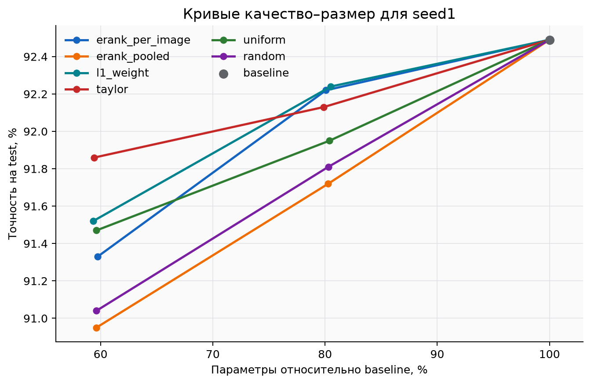
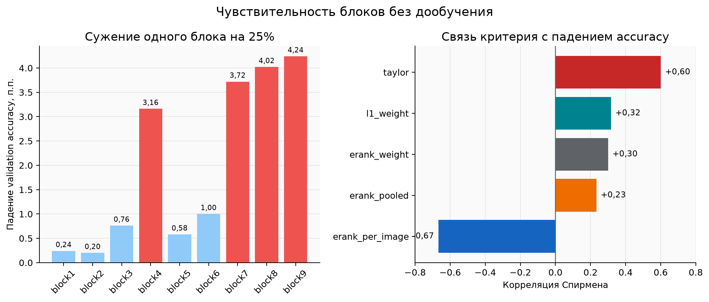

# Effective Rank как критерий выбора компактной архитектуры ResNet-20

## Аннотация

В работе проверяется, помогает ли Effective Rank выбирать внутреннюю ширину
блоков нейронной сети лучше классических критериев прунинга. Эксперимент
проведен на ResNet-20 и CIFAR-10. Полная модель `baseline` сравнивается с
компактными архитектурами двух размеров: `p080` сохраняет около 80% параметров,
а `p060` - около 60%.

Основное сравнение включает `erank_per_image`, `erank_pooled`, `l1_weight`,
`taylor` и `uniform`. Архитектура `random` используется как дополнительная
контрольная точка. Все основные модели обучены с нуля по одному протоколу.
Для `p060` выполнено по три независимых обучения, поэтому сравниваются не только
отдельные результаты, но и средние значения с разбросом.

Лучший средний результат среди компактных моделей `p060` получил `taylor`:
**91,65 ± 0,23%** на тестовой выборке. `erank_per_image` достиг
**91,46 ± 0,34%**, а `l1_weight` - **91,43 ± 0,18%**. Разница между этими тремя
методами мала по сравнению с разбросом между запусками. Поэтому эксперимент не
показывает убедительного превосходства Effective Rank над классическими
критериями, но показывает, что `erank_per_image` остается конкурентоспособным.

При почти одинаковом числе параметров методы распределяют каналы по слоям
по-разному. `erank_per_image` уменьшает число операций сильнее, чем
`l1_weight` и `taylor`, но слабее, чем `uniform`. Отдельная проверка
чувствительности блоков показывает, что `taylor` лучше всего согласуется с
падением качества при локальном сужении. Следовательно, в исследованной
ResNet-20 Effective Rank полезнее как способ построить целую архитектуру, чем
как прямой показатель того, какой отдельный блок безопасно сузить.

---

## 1. Термины и обозначения

Названия режимов оставлены такими же, как в коде, конфигурациях и каталогах
результатов.

| Термин | Определение |
|---|---|
| `baseline` | Полная ResNet-20 без уменьшения внутренних ширин. Служит точкой отсчета. |
| `p080` | Бюджет около 80% параметров `baseline`. |
| `p060` | Бюджет около 60% параметров `baseline`. |
| `erank_per_image` | Effective Rank вычисляется отдельно для каждого изображения, затем значения усредняются. |
| `erank_pooled` | Активации всей проверочной выборки объединяются в общую статистику, после чего вычисляется Effective Rank. |
| `erank_weight` | Effective Rank вычисляется по матрице весов слоя `Conv1`, а не по активациям. |
| `l1_weight` | Важность канала задается суммой модулей весов соответствующего фильтра `Conv1`. |
| `taylor` | Важность канала оценивается по произведению активации на градиент функции ошибки. Это приближенная оценка влияния удаления канала на ошибку. |
| `uniform` | Все группы блоков сужаются примерно в одной пропорции. |
| `random` | Ширины распределяются случайно при сохранении заданного бюджета. |
| `scratch` | Модель получает новую случайную инициализацию и обучается с нуля. |
| `finetune` | В компактную модель переносится совместимая часть весов `baseline`, после чего модель дообучается. |
| `seed1`, `seed2`, `seed3` | Независимые запуски с разными начальными случайными состояниями. |
| Внутренняя ширина | Число каналов между первым и вторым сверточными слоями остаточного блока. Именно эта величина изменяется. |
| Прунинг | Уменьшение модели за счет удаления каналов, фильтров или других элементов. |
| Effective Rank | Оценка эффективной размерности матрицы, учитывающая распределение ее сингулярных значений. |

Основные метрики:

| Метрика | Что показывает |
|---|---|
| `accuracy` | Долю правильно распознанных изображений. |
| `parameters` | Число обучаемых параметров модели. |
| `MACs` | Число операций умножения со сложением для пакета из 128 изображений. |
| `latency_median_ms` | Медианное время одного прохода модели. |
| `latency_p90_ms` | Время, быстрее которого завершились 90% измерений. |
| `images_per_second` | Число изображений, обрабатываемых за секунду. |
| `peak_cuda_memory_bytes` | Максимальный зафиксированный расход памяти CUDA. |
| Процентный пункт | Абсолютная разница между двумя значениями точности. |
| Стандартное отклонение | Наблюдаемый разброс результата между независимыми запусками. |

## 2. Цель и исследовательские вопросы

Цель работы - определить, насколько Effective Rank полезен для выбора
компактной архитектуры по сравнению с классическими критериями и простыми
контрольными способами сужения.

Проверяются следующие вопросы:

1. Какой критерий сохраняет наибольшую точность при одинаковом бюджете?
2. Насколько устойчив результат при разных `seed`?
3. Как качество меняется при переходе от `p080` к `p060`?
4. Как распределение каналов влияет на число операций, задержку и память?
5. Какие блоки наиболее чувствительны к уменьшению ширины?
6. Совпадают ли оценки критериев с измеренной чувствительностью блоков?

Рабочая гипотеза: если Effective Rank отражает сложность представлений внутри
блока, то найденное по нему распределение каналов должно сохранять качество
лучше `uniform` и быть не хуже классических критериев `l1_weight` и `taylor`.

## 3. Данные и модель

CIFAR-10 содержит 60 000 цветных изображений размером 32 × 32 пикселя из
десяти классов. Данные разделены следующим образом:

| Часть | Изображения | Назначение |
|---|---:|---|
| Обучающая | 45 000 | Обновление весов |
| Проверочная | 5 000 | Выбор лучшей эпохи и расчет критериев |
| Тестовая | 10 000 | Финальная независимая оценка |

Тестовая часть не участвует в обучении, выборе эпохи или поиске архитектуры.
Для обучения применяются случайная обрезка, горизонтальное отражение и
нормализация. Для проверки и теста используется только нормализация.

В `baseline` девять внутренних ширин ResNet-20 равны:

```text
[16, 16, 16, 32, 32, 32, 64, 64, 64]
```

Меняется только промежуточная ширина внутри остаточного блока:

```text
вход -> Conv1 -> BN1 -> ReLU -> Conv2 -> BN2 -> сложение с residual-связью
```

Входная и выходная ширина блока сохраняются. Поэтому разные варианты можно
сравнивать без изменения общей схемы ResNet-20.

## 4. Как формируются архитектуры

### 4.1. Effective Rank

Пусть сингулярные значения матрицы активаций или весов равны
$\sigma_1, \ldots, \sigma_n$. Сначала они превращаются в распределение:

$$
p_i = \frac{\sigma_i}{\sum_j \sigma_j}.
$$

Затем вычисляются энтропия и Effective Rank:

$$
H(p) = -\sum_i p_i \ln p_i, \qquad
r_{eff} = \exp(H(p)).
$$

Высокое значение означает, что заметный вклад дают многие независимые
направления. Низкое значение означает, что основная информация сосредоточена
в меньшем числе направлений. Это не готовое число каналов, а относительная
оценка, по которой распределяется общий бюджет.

`erank_per_image` сохраняет структуру отдельных изображений: ранг сначала
считается для каждого примера, а затем усредняется. `erank_pooled` описывает
общее пространство признаков всей проверочной выборки. `erank_weight` не
требует данных и использует только веса. В этом эксперименте `erank_weight` и
`erank_pooled` после округления дали одинаковые ширины, поэтому повторное
обучение идентичной сети не выполнялось.

### 4.2. Классические критерии

`l1_weight` считает канал важным, если модуль весов его фильтра в сумме велик.
Критерий прост и не требует вычисления градиентов.

`taylor` использует одновременно активацию и градиент. Если их произведение
велико, удаление канала может сильнее изменить функцию ошибки. Для расчета
выполнялся проход по 5 000 проверочным изображениям без шага оптимизатора:
веса при этом не обучались и не изменялись.

Оценки `l1_weight` и `taylor` нормировались внутри каждого слоя по L2-норме.
Затем каналы удалялись группами по два там, где отношение удаляемой важности к
экономии параметров было наименьшим. Для обоих критериев использовано одно
правило распределения бюджета; менялась только формула важности.

### 4.3. Контрольные способы

`uniform` проверяет, дает ли сложный критерий преимущество над почти
равномерным уменьшением сети. `random` показывает уровень одной случайно
сформированной архитектуры. Результат `random` рассматривается только как
дополнительный ориентир, поскольку для него построена одна архитектура на
каждый бюджет.

## 5. Протокол сравнения

Все основные `scratch`-модели обучались 160 эпох по единому протоколу:

| Параметр | Значение |
|---|---:|
| Оптимизатор | SGD с momentum и Nesterov |
| Начальный `learning rate` | 0,1 |
| Изменение `learning rate` | CosineAnnealing |
| Momentum | 0,9 |
| Weight decay | 0,0005 |
| Batch size | 128 |
| Выбор лучшей модели | максимум `validation accuracy` |

Для `p060` по три запуска выполнено для `erank_per_image`, `erank_pooled`,
`uniform`, `l1_weight` и `taylor`, а также для `baseline`. Для `p080` выполнен
один запуск каждого метода. Архитектуры во всех повторных запусках фиксированы:
разные `seed` проверяют устойчивость обучения выбранной сети, но не повторяют
поиск ширин.

Измерения производительности выполнены на одном GPU с одинаковым пакетом 128,
50 прогревочными и 200 измеряемыми проходами. Поэтому относительное сравнение
внутри таблицы надежнее, чем перенос абсолютного времени на другое устройство.

## 6. Полученные архитектуры

### 6.1. Бюджет `p060`

| Метод | Ширины блоков 1–9 | Параметры | Доля `baseline` |
|---|---|---:|---:|
| `baseline` | 16, 16, 16, 32, 32, 32, 64, 64, 64 | 272 474 | 100,00% |
| `erank_per_image` | 10, 12, 14, 24, 26, 26, 36, 36, 30 | 162 790 | 59,75% |
| `erank_pooled` | 8, 10, 10, 18, 20, 20, 36, 38, 38 | 162 470 | 59,63% |
| `uniform` | 10, 10, 10, 18, 18, 18, 38, 38, 38 | 162 470 | 59,63% |
| `l1_weight` | 16, 16, 16, 32, 32, 32, 64, 16, 16 | 161 690 | 59,34% |
| `taylor` | 16, 16, 16, 30, 32, 32, 52, 22, 20 | 161 970 | 59,44% |
| `random` | 8, 8, 16, 26, 26, 4, 24, 44, 42 | 162 470 | 59,63% |


Архитектуры близки по числу параметров, но устроены принципиально по-разному.
`l1_weight` вообще не сужает первые семь блоков и почти весь бюджет экономит в
блоках 8 и 9. `taylor` также сохраняет раннюю часть сети широкой, но начинает
сужение раньше. `erank_per_image` распределяет уменьшение по всей сети и
оставляет относительно больше каналов в средней группе блоков.

Это различие важно: параметр в позднем блоке и канал в раннем блоке имеют
разную вычислительную стоимость. Поэтому равный размер файла модели не означает
равное число операций.

### 6.2. Бюджет `p080`

| Метод | Ширины блоков 1–9 | Параметры | Доля `baseline` |
|---|---|---:|---:|
| `erank_per_image` | 14, 16, 16, 32, 32, 32, 50, 50, 42 | 218 226 | 80,09% |
| `erank_pooled` | 12, 12, 12, 24, 26, 26, 50, 52, 52 | 218 766 | 80,29% |
| `uniform` | 13, 13, 13, 26, 26, 26, 51, 51, 51 | 219 062 | 80,40% |
| `l1_weight` | 16, 16, 16, 32, 32, 32, 64, 42, 40 | 219 390 | 80,52% |
| `taylor` | 16, 16, 16, 32, 32, 32, 62, 42, 40 | 217 658 | 79,88% |
| `random` | 14, 12, 14, 28, 18, 22, 60, 48, 52 | 218 770 | 80,29% |

При `p080` различие подходов сохраняется. `l1_weight` и `taylor` снова почти
не изменяют первые семь блоков, а Effective Rank распределяет уменьшение шире.

## 7. Точность при бюджете `p060`

### 7.1. Основное сравнение по трем запускам

| Метод | `seed1` | `seed2` | `seed3` | Среднее ± отклонение | Потеря к `baseline` |
|---|---:|---:|---:|---:|---:|
| `baseline` | 92,49% | 92,04% | 91,80% | **92,11 ± 0,35%** | - |
| `taylor` | 91,86% | 91,41% | 91,69% | **91,65 ± 0,23%** | 0,46 п.п. |
| `erank_per_image` | 91,33% | 91,85% | 91,20% | **91,46 ± 0,34%** | 0,65 п.п. |
| `l1_weight` | 91,52% | 91,22% | 91,55% | **91,43 ± 0,18%** | 0,68 п.п. |
| `uniform` | 91,47% | 91,12% | 90,95% | **91,18 ± 0,27%** | 0,93 п.п. |
| `erank_pooled` | 90,95% | 91,03% | 90,64% | **90,87 ± 0,21%** | 1,24 п.п. |


`taylor` имеет лучшее среднее значение. Его преимущество над
`erank_per_image` равно 0,19 процентного пункта, а над `l1_weight` - 0,22.
Такие различия сопоставимы с разбросом между запусками, поэтому по трем `seed`
нельзя считать победу статистически убедительной.

`erank_per_image` и `l1_weight` практически равны: разница средних составляет
только 0,03 процентного пункта. При этом `erank_per_image` лучше `uniform` в
среднем на 0,28 пункта и лучше `erank_pooled` на 0,59 пункта. Превосходство над
`uniform` не повторяется в каждом запуске: при `seed1` `uniform` выше на 0,14
пункта, а при `seed2` и `seed3` выше `erank_per_image`.

### 7.2. Проверочная и тестовая выборки

| Метод | `validation accuracy` | `test accuracy` |
|---|---:|---:|
| `baseline` | 92,39 ± 0,30% | 92,11 ± 0,35% |
| `taylor` | 91,87 ± 0,29% | 91,65 ± 0,23% |
| `l1_weight` | 91,95 ± 0,16% | 91,43 ± 0,18% |
| `erank_per_image` | 91,75 ± 0,54% | 91,46 ± 0,34% |
| `uniform` | 91,59 ± 0,53% | 91,18 ± 0,27% |
| `erank_pooled` | 91,51 ± 0,39% | 90,87 ± 0,21% |

На проверочной выборке `l1_weight` немного выше `taylor`, а на тестовой порядок
меняется. Это еще одна причина не переоценивать различия в несколько десятых
процентного пункта.

## 8. Точность при бюджете `p080` и кривые качество–размер

Для `p080` доступен один запуск каждого метода:

| Метод | Параметры | `validation accuracy` | `test accuracy` |
|---|---:|---:|---:|
| `l1_weight` | 219 390 | 92,60% | **92,24%** |
| `erank_per_image` | 218 226 | 92,66% | **92,22%** |
| `taylor` | 217 658 | 92,72% | **92,13%** |
| `uniform` | 219 062 | **92,78%** | 91,95% |
| `random` | 218 770 | 92,76% | 91,81% |
| `erank_pooled` | 218 766 | 92,62% | 91,72% |

Три лучших результата различаются всего на 0,11 процентного пункта.
`l1_weight` выше `erank_per_image` на 0,02 пункта, а `erank_per_image` выше
`taylor` на 0,09. Один запуск не позволяет надежно упорядочить эти методы.



Кривые соединяют `p060`, `p080` и общую точку `baseline`. На всех уровнях
использован `seed1`, чтобы не смешивать средние значения и одиночные запуски.
При уменьшении бюджета с 80% до 60% точность падает у всех методов, но величина
падения различается. `taylor` и `l1_weight` хорошо сохраняют качество, однако
их архитектуры оставляют вычислительно дорогую раннюю часть сети почти полной.

## 9. Размер и вычислительная эффективность

### 9.1. Измерения `p060`

| Метод | Параметры | MACs на пакет | Медиана, мс | P90, мс | Изображений/с | Память CUDA |
|---|---:|---:|---:|---:|---:|---:|
| `baseline` | 272 474 | 5,224 млрд | 1,309 | 1,443 | 97 757 | 78,2 МБ |
| `taylor` | 161 970 | 4,299 млрд | 1,254 | 1,470 | 102 112 | 77,8 МБ |
| `l1_weight` | 161 690 | 4,318 млрд | 1,233 | 1,469 | 103 828 | 77,8 МБ |
| `erank_per_image` | 162 790 | 3,648 млрд | 1,216 | 1,740 | 105 250 | 77,8 МБ |
| `uniform` | 162 470 | 3,143 млрд | **1,081** | **1,185** | **118 354** | 69,4 МБ |
| `erank_pooled` | 162 470 | **3,129 млрд** | 1,144 | 1,265 | 111 889 | **69,4 МБ** |
| `random` | 162 470 | 3,214 млрд | 1,162 | 1,902 | 110 172 | 77,8 МБ |


### 9.2. Изменение относительно `baseline`

| Метод | Параметры | MACs | Медианная задержка | Пропускная способность | Память |
|---|---:|---:|---:|---:|---:|
| `taylor` | −40,56% | −17,70% | −4,26% | +4,45% | −0,56% |
| `l1_weight` | −40,66% | −17,34% | −5,85% | +6,21% | −0,57% |
| `erank_per_image` | −40,25% | −30,17% | −7,12% | +7,67% | −0,56% |
| `uniform` | −40,37% | −39,83% | −17,40% | +21,07% | −11,29% |
| `erank_pooled` | −40,37% | −40,10% | −12,63% | +14,46% | −11,30% |

По числу параметров все модели почти одинаковы, но по MACs различаются сильно.
`l1_weight` и `taylor` оставляют ранние и средние блоки широкими, поэтому
сокращение параметров примерно на 40% дает только 17–18% экономии операций.
`erank_per_image` распределяет сужение по сети и уменьшает MACs на 30,17%.

`uniform` обеспечивает наименьшую задержку и наибольшую пропускную способность.
Следовательно, лучший критерий зависит от цели. Если важна только точность при
фиксированном числе параметров, сильнее выглядит `taylor`. Если важен баланс
точности и операций, `erank_per_image` имеет преимущество перед `l1_weight` и
`taylor`. Если главная цель - скорость, лучшим в этом измерении оказался
`uniform`.

## 10. Чувствительность отдельных блоков

Каждый блок по очереди сужался на 25%, остальные блоки не менялись. Каналы
переносились из `baseline` по одному правилу L1. Дообучение не выполнялось, что
позволяет измерить немедленный ущерб от локального сужения.

| Блок | Ширина до | Ширина после | Падение `validation accuracy` |
|---|---:|---:|---:|
| `block1` | 16 | 12 | 0,24 п.п. |
| `block2` | 16 | 12 | 0,20 п.п. |
| `block3` | 16 | 12 | 0,76 п.п. |
| `block4` | 32 | 24 | 3,16 п.п. |
| `block5` | 32 | 24 | 0,58 п.п. |
| `block6` | 32 | 24 | 1,00 п.п. |
| `block7` | 64 | 48 | 3,72 п.п. |
| `block8` | 64 | 48 | 4,02 п.п. |
| `block9` | 64 | 48 | 4,24 п.п. |



Самыми чувствительными оказались `block4` и последние три блока. Первые два
блока перенесли уменьшение значительно лучше. Это не означает, что поздние
блоки нельзя сужать после полного переобучения, но показывает, что их локальное
изменение сильнее нарушает уже обученную сеть.

Связь критерия с падением точности оценена корреляцией Спирмена:

| Критерий | Корреляция с падением точности |
|---|---:|
| `taylor` | **+0,60** |
| `l1_weight` | +0,32 |
| `erank_weight` | +0,30 |
| `erank_pooled` | +0,23 |
| `erank_per_image` | **−0,67** |

Для этого теста положительное значение желательно: более высокая оценка должна
соответствовать большему ущербу при сужении. Лучше всего это условие выполняет
`taylor`. Отрицательная связь `erank_per_image` означает, что его локальная
оценка не предсказывает чувствительность отдельных блоков. Особенно заметно
расхождение в `block7`–`block9`: они получили сравнительно низкие отношения
Effective Rank, но показали большое падение точности при прямом сужении.

Этот результат не противоречит хорошей точности целой архитектуры
`erank_per_image`. При обучении с нуля все слои совместно приспосабливаются к
новым ширинам, тогда как тест чувствительности изменяет один слой уже обученной
сети и не дает ей восстановиться.

## 11. Роль `finetune`

`finetune` использовался как отдельная проверка для архитектур, построенных по
Effective Rank и контрольным правилам. Конкретные каналы во всех случаях
переносились по L1-норме, поэтому сравнивалось распределение ширин, а не разные
правила переноса.

| Бюджет | Метод | `scratch`, `seed1` | `finetune`, `seed1` | Разница |
|---|---|---:|---:|---:|
| `p060` | `erank_per_image` | 91,33% | 91,70% | +0,37 п.п. |
| `p060` | `erank_pooled` | 90,95% | 91,17% | +0,22 п.п. |
| `p060` | `uniform` | 91,47% | 91,05% | −0,42 п.п. |
| `p060` | `random` | 91,04% | 91,00% | −0,04 п.п. |
| `p080` | `erank_per_image` | 92,22% | 92,07% | −0,15 п.п. |
| `p080` | `erank_pooled` | 91,72% | 91,83% | +0,11 п.п. |
| `p080` | `uniform` | 91,95% | 92,23% | +0,28 п.п. |
| `p080` | `random` | 91,81% | 91,66% | −0,15 п.п. |

Улучшение не является постоянным: в четырех случаях результат вырос, в четырех
снизился или почти не изменился. Поэтому итоговое сравнение критериев основано
на `scratch`, где каждая архитектура получает одинаковые 160 эпох и не зависит
от качества переноса весов. Для ответа о `l1_weight` и `taylor` отдельный
`finetune` не требуется: эти названия обозначают способ выбрать ширины, а не
обязательный способ инициализировать компактную модель.

## 12. Ответ на основной вопрос проекта

### Насколько Effective Rank полезен по сравнению с классическими критериями?

Effective Rank полезен, но не показал общего превосходства. При `p060`
`erank_per_image` почти равен `l1_weight` по точности и уступает `taylor` в
среднем на 0,19 процентного пункта. При `p080` он почти равен `l1_weight` и
`taylor`: разница между тремя методами не превышает 0,11 пункта.

Практическое преимущество `erank_per_image` проявляется в другой части баланса:
при почти том же числе параметров он требует заметно меньше MACs, чем
`l1_weight` и `taylor`. Значит, он лучше распределяет сокращение по
вычислительно дорогим частям сети, хотя `uniform` остается еще быстрее.

### На каких слоях критерий работает лучше или хуже?

`erank_per_image` формирует конкурентоспособную целую архитектуру и разумно
сохраняет среднюю группу блоков. Однако как предсказатель чувствительности
отдельного слоя он работает хуже `taylor`. Наиболее проблемное место - поздние
`block7`–`block9`: Effective Rank оценивает их как подходящие для сильного
сужения, тогда как локальный тест показывает большое падение качества.

`taylor` лучше согласуется с чувствительностью блоков и дает лучшую среднюю
точность `p060`, но его архитектура сохраняет ранние блоки почти полными и
поэтому слабее сокращает вычисления. `l1_weight` показывает похожее поведение,
но его связь с чувствительностью слоев слабее.

### На каких моделях вывод подтвержден?

Вывод подтвержден только для ResNet-20 на CIFAR-10. В работе исследуется одна
модель, поэтому нельзя утверждать, что тот же порядок методов сохранится для
ResNet-18, CIFAR-100, ImageNet или архитектур без остаточных блоков. Это граница
полученного результата, а не отрицательный вывод о других моделях.

## 13. Ограничения достоверности

1. Три независимых запуска выполнены для основного бюджета `p060`; для `p080`
   доступен один запуск.
2. Повторные запуски обучают фиксированные архитектуры. Полный поиск ширин для
   каждой новой `baseline` не повторяется.
3. `random` представлен одной случайной архитектурой и не используется для
   строгого статистического вывода.
4. Анализ чувствительности выполняется без дообучения и измеряет краткосрочный
   ущерб переноса, а не окончательное качество после 160 эпох.
5. Исследована одна модель и один набор данных.
6. Различия порядка нескольких десятых процентного пункта сопоставимы с
   наблюдаемым разбросом; отдельный статистический тест не проводился.
7. Абсолютная задержка зависит от GPU, версий библиотек и фоновой нагрузки.

Эти ограничения не отменяют измеренные результаты, но определяют точность
формулировок: можно говорить о конкурентоспособности методов в проведенном
эксперименте, но нельзя объявлять один критерий универсально лучшим.

## 14. Итоговые выводы

1. Все исследованные критерии позволяют убрать около 40% параметров ResNet-20
   при потере менее 1,25 процентного пункта средней тестовой точности.
2. Лучший средний результат `p060` получил `taylor` - **91,65 ± 0,23%**.
3. `erank_per_image` достиг **91,46 ± 0,34%** и практически сравнялся с
   `l1_weight` - **91,43 ± 0,18%**.
4. Превосходство `taylor` над `erank_per_image` равно 0,19 процентного пункта и
   недостаточно велико для уверенного вывода по трем запускам.
5. `erank_per_image` превосходит `erank_pooled` при обоих бюджетах, поэтому
   расчет ранга отдельно по изображениям оказался более полезным способом
   построения архитектуры.
6. При `p060` `erank_per_image` сокращает MACs на 30,17%, тогда как
   `l1_weight` и `taylor` - примерно на 17–18%. По балансу точности и вычислений
   Effective Rank выглядит сильнее этих двух классических вариантов.
7. `uniform` дает лучшую реальную скорость, но уступает по средней точности.
8. В анализе отдельных слоев лучше всего работает `taylor` с корреляцией
   +0,60. `erank_per_image` имеет отрицательную корреляцию −0,67 и особенно
   плохо отражает чувствительность последних трех блоков.
9. Итоговый ответ: Effective Rank полезен как конкурентоспособная эвристика
   распределения ширины всей сети, но не доказан как лучший универсальный
   критерий и не подходит для прямой оценки чувствительности каждого слоя.

## Использованные работы

1. He K., Zhang X., Ren S., Sun J. *Deep Residual Learning for Image Recognition*. 2016.
2. Roy O., Vetterli M. *The Effective Rank: A Measure of Effective Dimensionality*. 2007.
3. Krizhevsky A. *Learning Multiple Layers of Features from Tiny Images*. 2009.
4. Li H., Kadav A., Durdanovic I., Samet H., Graf H. P. *Pruning Filters for Efficient ConvNets*. 2016.
5. Molchanov P., Tyree S., Karras T., Aila T., Kautz J. *Pruning Convolutional Neural Networks for Resource Efficient Inference*. 2017.
