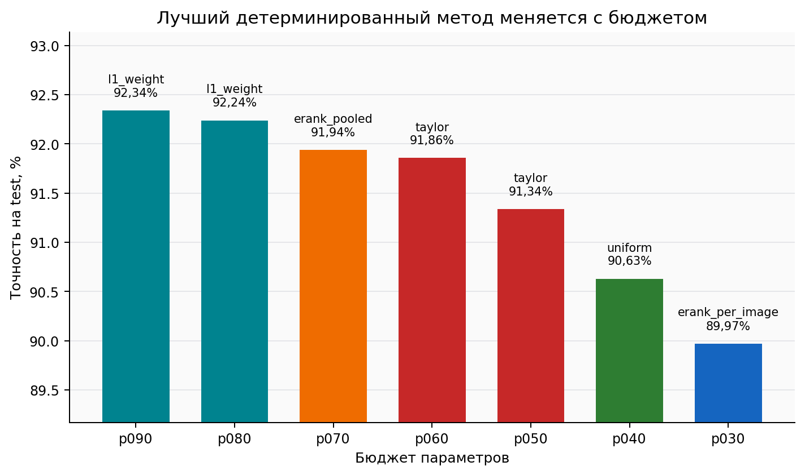
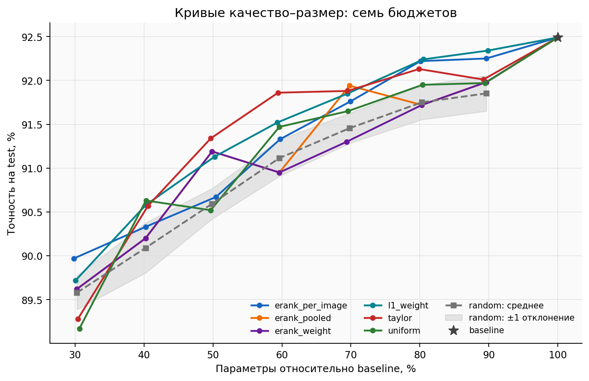
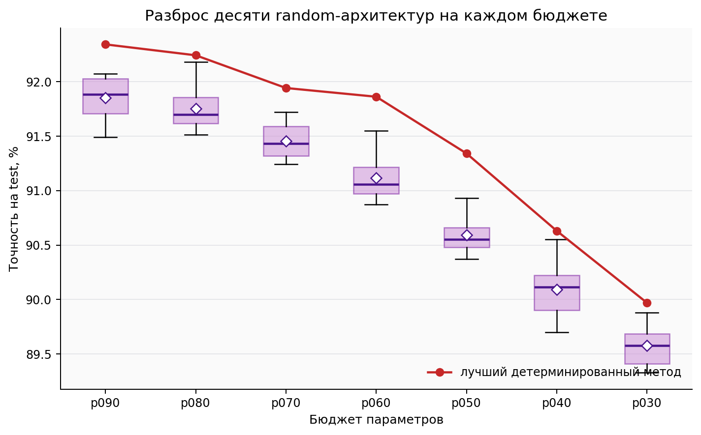
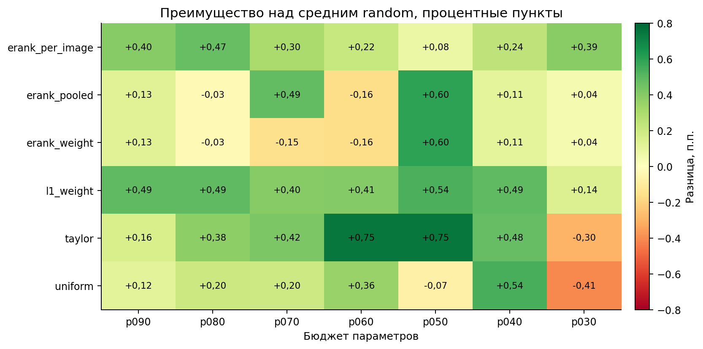
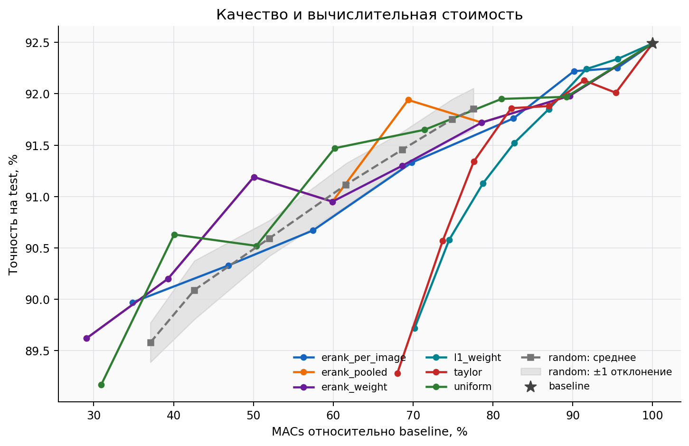
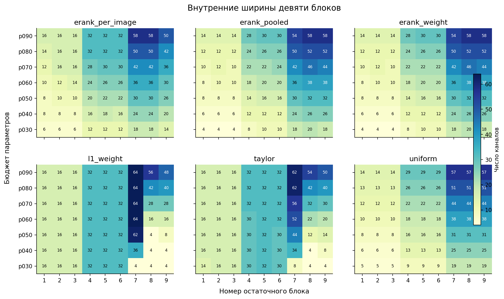
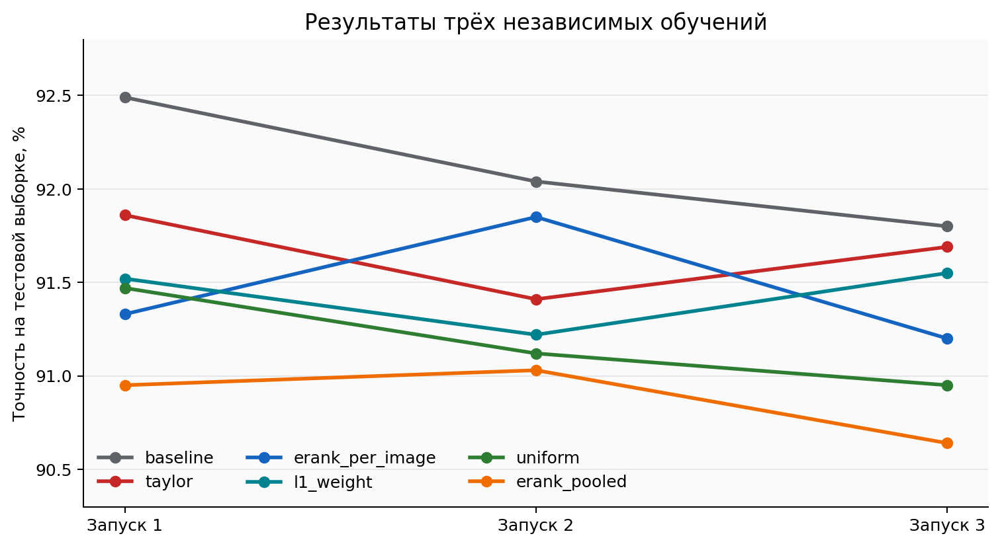
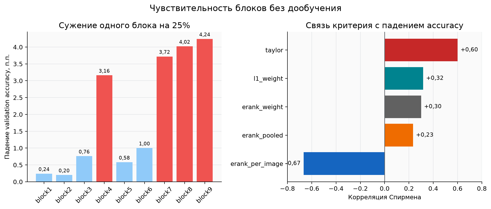

# Effective Rank как критерий выбора компактной архитектуры ResNet-20

## Аннотация

В работе исследуется, насколько Effective Rank полезен для выбора ширины
остаточных блоков нейронной сети по сравнению с классическими критериями
прунинга и простыми контрольными способами. Эксперимент выполнен на ResNet-20
и CIFAR-10. В полной модели изменяемыми являются девять внутренних ширин — по
одной для каждого остаточного блока.

Основное одношаговое сравнение охватывает семь бюджетов: от `p090`, где
сохраняется около 90% параметров полной модели, до `p030`, где сохраняется
около 30%. Рассматриваются `erank_per_image`, `erank_pooled`, `erank_weight`,
`l1_weight`, `taylor`, `uniform` и `random`. Все модели основной сетки обучены
с нуля по одному протоколу при `train_seed=1`. Для `random` на каждом бюджете
проверено десять разных профилей ширин с `architecture_seed=1001...1010`.
Всего выполнено 106 физических обучений и 106 оценок на официальной тестовой
выборке.

Результаты не выявили одного метода, лучшего при любом размере. При слабом
сжатии `p090` и `p080` максимальную точность показал `l1_weight`; на `p070` —
`erank_pooled`; на `p060` и `p050` — `taylor`; на `p040` — `uniform`; при
сильном сжатии `p030` — `erank_per_image`. Следовательно, полезность критерия
зависит от допустимого размера модели и от того, оптимизируется ли число
параметров или число операций.

Effective Rank оказался содержательным критерием построения архитектуры, но не
универсальной заменой классических методов. `erank_per_image` во всех семи
точках превысил средний результат `random`, а на `p030` стал лучшим методом.
`erank_pooled` чаще обеспечивает хорошее соотношение точности и MACs, однако
проигрывает по точности в ряде бюджетов. Повторные обучения на `p060`
показывают, что различия в несколько десятых процентного пункта сопоставимы с
разбросом между запусками. Поэтому окончательные выводы формулируются по форме
кривых и устойчивым различиям, а не по минимальному преимуществу одной точки.

---

## 1. Термины и обозначения

Названия методов оставлены такими же, как в коде, конфигурациях и каталогах
результатов.

| Термин | Определение |
|---|---|
| `baseline` | Полная ResNet-20 с внутренними ширинами `[16, 16, 16, 32, 32, 32, 64, 64, 64]`. |
| Бюджет `pXYZ` | Целевая доля параметров от `baseline`. Например, `p060` означает около 60%, а не удаление 60%. |
| Внутренняя ширина | Число каналов между первым и вторым сверточными слоями остаточного блока. |
| `erank_per_image` | Effective Rank активаций вычисляется отдельно для каждого изображения, затем значения усредняются по 5 000 изображениям проверочной выборки. |
| `erank_pooled` | Активации проверочной выборки рассматриваются как общее пространство признаков; ранг получается из общей ковариационной статистики. |
| `erank_weight` | Effective Rank вычисляется по матрице весов первого сверточного слоя блока. |
| `l1_weight` | Важность канала задаётся суммой модулей весов соответствующего фильтра. |
| `taylor` | Важность канала приближённо оценивается по произведению активации на градиент функции ошибки. |
| `uniform` | Все группы блоков уменьшаются примерно в одинаковой пропорции. |
| `random` | Девять ширин распределяются случайно при сохранении заданного общего бюджета параметров. |
| `scratch` | Модель получает случайные начальные веса и обучается с нуля. |
| `finetune` | Модель получает часть весов обученной полной сети и затем дообучается. Результаты этого режима не смешиваются с основной `scratch`-сеткой. |
| `train_seed` | Случайность инициализации модели и порядка обучающих данных. |
| `architecture_seed` | Случайность выбора девяти ширин для метода `random`. |
| `aliases` | Несколько названий методов, которые дали один и тот же профиль ширин. Такая сеть обучается один раз. |
| MAC | Одна операция умножения с последующим сложением. Используется как оценка вычислительной стоимости. |
| Процентный пункт | Абсолютная разница двух значений точности. Например, 92% минус 91% равно 1 процентному пункту. |
| Стандартное отклонение | Мера разброса результатов вокруг среднего значения. |

## 2. Цель и исследовательские вопросы

Цель работы — определить, помогает ли Effective Rank выбирать компактную
архитектуру ResNet-20 лучше классических критериев и простых контрольных
способов.

Проверяются следующие вопросы:

1. Как меняется точность каждого метода при постепенном уменьшении модели?
2. Есть ли метод, который выигрывает на всём диапазоне размеров?
3. Насколько результаты методов превосходят случайное распределение ширин?
4. Совпадает ли уменьшение параметров с уменьшением числа операций?
5. Какие способы Effective Rank работают лучше при слабом и сильном сжатии?
6. Насколько устойчивы выводы к случайности обучения?
7. Согласуются ли значения критериев с чувствительностью отдельных блоков?

Основная гипотеза: если Effective Rank отражает требуемую размерность
представлений, то построенная по нему архитектура должна систематически
превосходить средний `random` и оставаться конкурентоспособной относительно
`l1_weight` и `taylor`.

## 3. Данные, модель и инфраструктура

### 3.1. Данные

CIFAR-10 содержит 60 000 цветных изображений размером 32 × 32 пикселя из
десяти классов. Использовано следующее разделение:

| Часть | Изображения | Назначение |
|---|---:|---|
| Обучающая | 45 000 | Обновление весов модели |
| Проверочная | 5 000 | Выбор лучшей эпохи и расчёт критериев |
| Тестовая | 10 000 | Окончательная независимая оценка |

Тестовая часть не использовалась для обучения, выбора лучшей эпохи или
построения архитектуры. Для обучения применялись случайная обрезка,
горизонтальное отражение и нормализация; для проверки и теста — нормализация.

### 3.2. Модель

Исходная ResNet-20 содержит девять остаточных блоков, объединённых в три
группы. Полные внутренние ширины равны:

```text
[16, 16, 16, 32, 32, 32, 64, 64, 64]
```

В каждом блоке изменяется только промежуточная ширина `M`:

```text
C_in -> Conv1 -> BN -> ReLU -> Conv2 -> C_out
```

Входная и выходная ширины блока остаются стандартными. Поэтому остаточное
сложение не нарушается, а любой допустимый набор из девяти значений можно
обучать одной реализацией модели.

Полная модель содержит 272 474 обучаемых параметра и требует 40 813 184 MACs
на одно изображение. При `train_seed=1` её точность на тестовой выборке равна
92,49%.

### 3.3. Вычислительная инфраструктура

| Компонент | Конфигурация основного запуска |
|---|---|
| Операционная система | Manjaro Linux |
| Процессор | Intel Core Ultra 7 265KF |
| Видеокарта | NVIDIA GeForce RTX 5070 Ti, 16 ГБ |
| Оперативная память | 64 ГБ |
| Python | 3.14.7 |
| PyTorch | 2.14.1+cu130 |
| CUDA runtime PyTorch | 13.0 |
| cuDNN | 92400 |

Точные сведения о программном окружении сохранены в `environment.json`
каждого запуска.

## 4. Как строились архитектуры

### 4.1. Effective Rank

Для матрицы активаций или весов вычисляются сингулярные значения
$\sigma_1, \ldots, \sigma_n$. Они нормируются:

$$
p_i = \frac{\sigma_i}{\sum_j \sigma_j}.
$$

После этого вычисляются энтропия и Effective Rank:

$$
H(p) = -\sum_i p_i \ln p_i,
\qquad
r_{eff} = \exp(H(p)).
$$

Если вклад сосредоточен в одном или нескольких направлениях, энтропия и
Effective Rank невелики. Если заметный вклад распределён между многими
направлениями, Effective Rank выше. Полученное число не является готовой
шириной блока: оно служит относительной оценкой, по которой между девятью
блоками распределяется общий бюджет.

`erank_per_image` сохраняет структуру отдельного изображения: для каждого
примера формируется матрица «пространственные позиции × каналы», вычисляется её
ранг, после чего результаты усредняются по проверочной выборке.

`erank_pooled` отвечает на другой вопрос — насколько разнообразно общее
пространство признаков всей выборки. Все тензоры не сохраняются одновременно:
по пакетам накапливаются число наблюдений, сумма признаков и матрица
$X^T X$. Из этой статистики получается общая центрированная ковариационная
матрица и её спектр.

`erank_weight` не использует изображения и вычисляет ранг по развёрнутой
матрице весов `Conv1`. На шести бюджетах из семи он дал те же ширины, что и
`erank_pooled`; на `p070` профили различились. Совпадающие сети обучались один
раз, а эквивалентность сохранена в `aliases`.

### 4.2. Классические критерии

`l1_weight` считает канал важным, если сумма модулей весов его фильтра велика.
Критерий прост, не требует данных и градиентов.

`taylor` использует активацию и градиент функции ошибки. Большое произведение
указывает, что удаление канала может заметно изменить ошибку. Для расчёта
использовались 5 000 проверочных изображений. Оптимизатор не выполнял шагов,
поэтому веса на этом этапе не изменялись.

Для обоих критериев оценки нормировались внутри слоя. Затем ширины уменьшались
там, где отношение удаляемой важности к экономии параметров было наименьшим.

### 4.3. Контрольные методы

`uniform` проверяет, даёт ли сложный критерий преимущество над почти
равномерным уменьшением всех групп. `random` проверяет, лучше ли результат
осмысленного критерия случайного распределения того же бюджета.

На каждый бюджет сформировано десять разных `random`-архитектур. Их
`architecture_seed` изменяется от 1001 до 1010, но все модели обучаются при
одном `train_seed=1`. Поэтому их разброс описывает влияние профиля ширин, а не
случайной инициализации одной и той же сети.

## 5. Протокол основной одношаговой сетки

Все компактные модели обучались с нуля по одному протоколу:

| Параметр | Значение |
|---|---:|
| Эпохи | 160 |
| Оптимизатор | SGD с momentum и Nesterov |
| Начальный `learning rate` | 0,1 |
| Изменение `learning rate` | CosineAnnealing |
| Momentum | 0,9 |
| Weight decay | 0,0005 |
| Batch size | 128 |
| AMP | включён на CUDA |
| Выбор лучшей модели | максимум `validation accuracy` |
| `train_seed` основной сетки | 1 |

Исследованы `p090`, `p080`, `p070`, `p060`, `p050`, `p040`, `p030`. На каждом
бюджете есть шесть детерминированных методов и десять `random`-профилей.
Совпадающие детерминированные профили не обучались повторно. Поэтому прямое
произведение 7 × 16 даёт 112 логических точек сравнения, но фактически
потребовалось 106 обучений.

## 6. Результаты расширенной сетки

### 6.1. Точность всех детерминированных методов

Все числа в таблице относятся к `train_seed=1`.

| Бюджет | `erank_per_image` | `erank_pooled` | `erank_weight` | `l1_weight` | `taylor` | `uniform` |
|---|---:|---:|---:|---:|---:|---:|
| `p090` | 92,25% | 91,98% | 91,98% | **92,34%** | 92,01% | 91,97% |
| `p080` | 92,22% | 91,72% | 91,72% | **92,24%** | 92,13% | 91,95% |
| `p070` | 91,76% | **91,94%** | 91,30% | 91,85% | 91,88% | 91,65% |
| `p060` | 91,33% | 90,95% | 90,95% | 91,52% | **91,86%** | 91,47% |
| `p050` | 90,67% | 91,19% | 91,19% | 91,13% | **91,34%** | 90,52% |
| `p040` | 90,33% | 90,20% | 90,20% | 90,58% | 90,57% | **90,63%** |
| `p030` | **89,97%** | 89,62% | 89,62% | 89,72% | 89,28% | 89,17% |



Лидер меняется пять раз. Это означает, что вопрос «какой критерий лучший» без
указания бюджета поставлен неполно. `l1_weight` лучше сохраняет точность при
слабом сжатии; `taylor` выигрывает в средней области; один из вариантов
Effective Rank становится лучшим на `p070` и `p030`.

Особенно важен `p030`: `erank_per_image` превосходит `l1_weight` на 0,25
процентного пункта, `taylor` — на 0,69, `uniform` — на 0,80. Это подтверждает,
что критерий активаций может быть полезнее при жёстком ограничении размера.
Однако одна точка одного `train_seed` ещё не доказывает универсальность этого
преимущества.

### 6.2. Кривые качество–размер



Кривые показывают полную траекторию, а не только две выбранные точки. Основные
наблюдения:

- `erank_per_image` ведёт себя устойчиво: он выше среднего `random` на всех
  бюджетах и не имеет резкого провала в середине диапазона;
- `erank_pooled` и `erank_weight` совпадают в шести точках, но на `p070`
  `erank_pooled` получает 91,94%, а `erank_weight` — 91,30%;
- `l1_weight` силён от `p090` до `p040`, но на `p030` уступает
  `erank_per_image`;
- `taylor` показывает лучший результат на `p060` и `p050`, но резко ухудшается
  на `p030`;
- `uniform` не является заведомо слабым контролем: он выигрывает на `p040`.

### 6.3. Сравнение с десятью случайными архитектурами

| Бюджет | Среднее `random` | Отклонение | Минимум | Максимум | Лучший детерминированный метод |
|---|---:|---:|---:|---:|---:|
| `p090` | 91,85% | 0,20 | 91,49% | 92,07% | 92,34% |
| `p080` | 91,75% | 0,20 | 91,51% | 92,18% | 92,24% |
| `p070` | 91,45% | 0,17 | 91,24% | 91,72% | 91,94% |
| `p060` | 91,11% | 0,21 | 90,87% | 91,55% | 91,86% |
| `p050` | 90,59% | 0,17 | 90,37% | 90,93% | 91,34% |
| `p040` | 90,09% | 0,29 | 89,70% | 90,55% | 90,63% |
| `p030` | 89,58% | 0,19 | 89,33% | 89,88% | 89,97% |



Лучший детерминированный метод выше среднего `random` на 0,39–0,75
процентного пункта на каждом бюджете. Во всех семи бюджетах он также выше
лучшей из десяти случайных архитектур. На `p060` и `p040` лучшая случайная
архитектура приближается к лидеру, но не превосходит его.



`erank_per_image` — единственный вариант Effective Rank, который выше среднего
`random` во всех семи точках. Его преимущество составляет от 0,08 до 0,47
процентного пункта. У `erank_pooled` и `erank_weight` есть отрицательные точки,
а `taylor` и `uniform` проигрывают среднему `random` на `p030`.

### 6.4. Параметры и MACs — разные ограничения

Число параметров определяет размер весов, но не полностью описывает объём
вычислений. Канал в раннем блоке обрабатывает карту 32 × 32 или 16 × 16 и
используется во многих пространственных позициях. Канал позднего блока работает
с меньшей картой 8 × 8. Поэтому удаление большого числа поздних параметров
может мало уменьшить MACs.

| Бюджет | `erank_per_image` | `erank_pooled` | `erank_weight` | `l1_weight` | `taylor` | `uniform` |
|---|---:|---:|---:|---:|---:|---:|
| `p090` | 95,6% | 89,6% | 89,6% | 95,7% | 95,4% | 89,2% |
| `p080` | 90,2% | 78,6% | 78,6% | 91,7% | 91,4% | 81,1% |
| `p070` | 82,6% | 69,4% | 68,7% | 87,0% | 87,0% | 71,5% |
| `p060` | 69,8% | 59,9% | 59,9% | 82,7% | 82,3% | 60,2% |
| `p050` | 57,5% | 50,1% | 50,1% | 78,8% | 77,6% | 50,4% |
| `p040` | 46,9% | 39,3% | 39,3% | 74,5% | 73,7% | 40,1% |
| `p030` | 34,9% | 29,1% | 29,1% | 70,2% | 68,0% | 30,9% |

В таблице показана доля MACs от полной модели. Хотя все методы в строке
`p030` имеют около 30% параметров, `erank_pooled` требует 29,1% исходных MACs,
а `l1_weight` — 70,2%. Причина видна в профилях ширин: `l1_weight` почти
полностью сохраняет первые шесть блоков и экономит параметры в последних.



Если главным ограничением является размер файла модели, результаты таблицы
точности сравниваются при равных условиях. Если важнее реальная
вычислительная стоимость, `l1_weight` и `taylor` уже нельзя считать столь же
компактными: их преимущество в точности покупается заметно большим числом
операций. В таком сравнении `erank_pooled`, `uniform` и местами
`erank_per_image` образуют более выгодные точки.

### 6.5. Как методы распределяют ширины



У методов наблюдаются разные устойчивые стратегии:

- `l1_weight` до `p040` сохраняет первые шесть блоков полными и в первую
  очередь сужает блоки 8–9;
- `taylor` действует похоже, но начинает уменьшать среднюю часть раньше;
- `uniform` пропорционально уменьшает все три группы;
- `erank_pooled` и `erank_weight` распределяют уменьшение по всей сети;
- `erank_per_image` дольше сохраняет блоки 2–6 и сильнее сужает последний блок.

Именно эти профили объясняют расхождение между долей параметров и долей MACs.
Они также показывают, что сравниваются не разные способы удалить каналы из
одного профиля, а разные архитектурные решения.

## 7. Устойчивость к случайности обучения

Расширенная сетка использует один `train_seed`, поскольку её задача — получить
форму кривых на большом числе архитектур. Для проверки влияния обучения ранее
выполнено по три независимых запуска пяти методов на `p060`.

| Метод | `seed1` | `seed2` | `seed3` | Среднее ± отклонение |
|---|---:|---:|---:|---:|
| `taylor` | 91,86% | 91,41% | 91,69% | **91,65 ± 0,23%** |
| `erank_per_image` | 91,33% | 91,85% | 91,20% | **91,46 ± 0,34%** |
| `l1_weight` | 91,52% | 91,22% | 91,55% | **91,43 ± 0,18%** |
| `uniform` | 91,47% | 91,12% | 90,95% | **91,18 ± 0,27%** |
| `erank_pooled` | 90,95% | 91,03% | 90,64% | **90,87 ± 0,21%** |



Разница средних между `taylor` и `erank_per_image` равна 0,19 процентного
пункта, а между `erank_per_image` и `l1_weight` — 0,03. Эти значения меньше
или сопоставимы со стандартным отклонением. Поэтому утверждать строгое
превосходство одного из этих трёх методов на `p060` нельзя. Более надёжный
вывод состоит в том, что они образуют конкурентную группу, а
`erank_pooled` в данном бюджете заметно слабее.

Разброс `random` и разброс повторных обучений имеют разный смысл. В первом
случае меняется архитектура при фиксированном обучении; во втором меняется
обучение одной фиксированной архитектуры.

## 8. Чувствительность отдельных блоков

Для дополнительной проверки каждый блок полной модели по очереди сужался на
25%. Остальные блоки не изменялись, веса переносились по одному правилу L1,
дообучение не выполнялось.



Наиболее чувствительными оказались блоки 7–9: уменьшение каждого из них
привело к падению проверочной точности на 3,72–4,24 процентного пункта. Среди
критериев лучшую положительную связь с измеренным падением показал `taylor`:
корреляция Спирмена равна 0,60. Для `l1_weight` она равна 0,32, для
`erank_weight` — 0,30, для `erank_pooled` — 0,23.

У `erank_per_image` корреляция отрицательная: −0,67. Это не противоречит его
конкурентной точности целой сети. Локальная проверка задаёт вопрос «что
произойдёт, если независимо сузить один блок без дообучения», а построение
архитектуры распределяет общий бюджет сразу между девятью блоками и затем
обучает новую сеть с нуля. Критерий может быть полезен для общего профиля и
при этом плохо служить прямой оценкой локальной чувствительности.

## 9. Ответ на основной вопрос проекта

Effective Rank полезен, но его преимущество зависит от режима сравнения.

1. **По точности при равном числе параметров.** Нет универсального победителя.
   `l1_weight` лучше при слабом сжатии, `taylor` — в средней области,
   `erank_per_image` — при самом сильном исследованном сжатии. Effective Rank
   конкурентоспособен, но не заменяет классические критерии во всех условиях.

2. **По сравнению со случайным выбором архитектуры.** `erank_per_image`
   устойчиво выше среднего `random` на всех семи бюджетах. Это показывает, что
   он извлекает полезный сигнал, а не просто создаёт произвольный профиль.

3. **По числу операций.** `erank_pooled` и `uniform` обычно уменьшают MACs
   почти пропорционально параметрам. `l1_weight` и `taylor` сохраняют ранние
   дорогие блоки и поэтому при том же размере требуют существенно больше
   операций. Если цель — ускорение, сравнение только по параметрам может дать
   неверный практический выбор.

4. **По слоям.** Effective Rank лучше работает как правило построения полного
   профиля ширин, чем как прямая локальная оценка безопасности удаления каналов.
   Для локальной чувствительности блоков `taylor` согласуется с измерениями
   лучше.

5. **По вариантам Effective Rank.** `erank_per_image` наиболее устойчив
   относительно `random` и выигрывает на `p030`. `erank_pooled` даёт хорошие
   точки по MACs и выигрывает на `p070`, но его точность менее стабильна по
   бюджетам. `erank_weight` почти всегда повторяет `erank_pooled`, а в
   единственной отличающейся точке `p070` показывает худший результат.

## 10. Ограничения и дальнейшая проверка

- Расширенная сетка построена по одной исходной `baseline` и обучена при одном
  `train_seed`. Повторные запуски выполнены только для `p060`.
- Исследование относится к ResNet-20 и CIFAR-10; перенос выводов на другие
  модели требует отдельной проверки.
- Выполнен одношаговый поиск: критерии вычислены один раз по полной модели.
- MACs являются точным счётом сверточных и линейных операций для данной
  реализации, но не равны реальной задержке на любом устройстве.
- Основная сетка оценивает архитектуру в режиме `scratch`. Выбор конкретных
  переносимых каналов и режим `finetune` являются отдельным фактором.

Следующий этап исследования разделён на две части. Сначала отдельно
сравниваются способы переноса каналов при фиксированных ширинах, чтобы не
смешивать качество архитектуры с качеством инициализации. Затем выполняется
итеративный поиск: после изменения сети критерий рассчитывается повторно, и
архитектура уточняется несколькими шагами.

## 11. Воспроизводимость

Полные команды воспроизведения приведены в `README.md` и
`V08_GRID_RUNBOOK.md`. Основные машиночитаемые результаты находятся в:

- `configs/generated_v4/manifest.json` — состав сетки;
- `reports/data/final_results.json` — повторения `p060` и чувствительность;
- `reports/data/grid_results_v09.json` — проверенная сводка v09;
- `results/summary_v09/summary.json` — полная сводка;
- `results/summary_v09/method_points.csv` — таблица логических точек;
- `results/summary_v09/summary.md` — краткая таблица результатов.

Сводка и графики перестраиваются без обучения:

```bash
python -m project_rank.grid_analysis
python -m project_rank.plot_results
python -m project_rank.plot_grid_results
```

## 12. Итоговые выводы

1. Расширение сетки с двух до семи бюджетов изменило интерпретацию результата:
   лидер зависит от степени сжатия.
2. `erank_per_image` систематически превосходит средний `random` и лучше всех
   сохраняет точность при `p030`.
3. `l1_weight` и `taylor` дают высокую точность, но часто сохраняют слишком
   много вычислений в ранних блоках.
4. `erank_pooled` полезен при ограничении MACs, особенно в средней части
   диапазона, но не всегда выигрывает по точности.
5. На `p060` различия `taylor`, `erank_per_image` и `l1_weight` сопоставимы с
   разбросом обучения; небольшие различия одной точки нельзя переоценивать.
6. Для ResNet-20 Effective Rank следует рассматривать как один из способов
   распределения общего бюджета между блоками, а не как универсальный критерий
   удаления отдельного канала или слоя.
