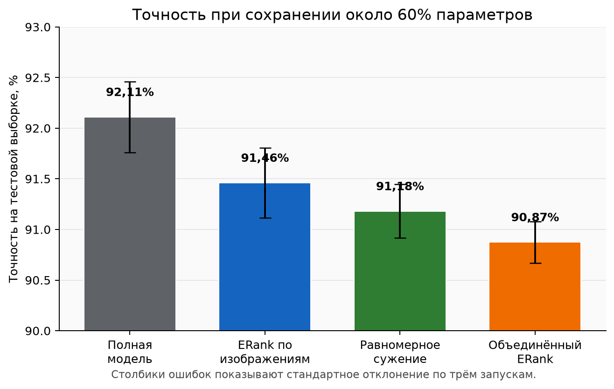
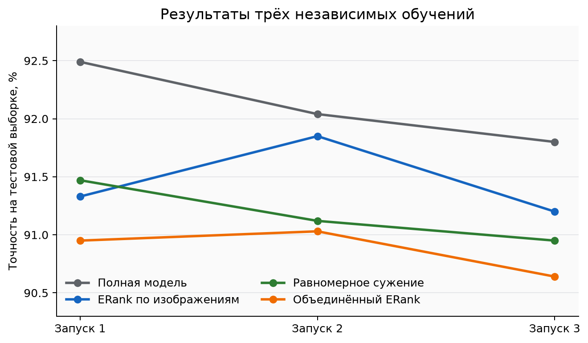
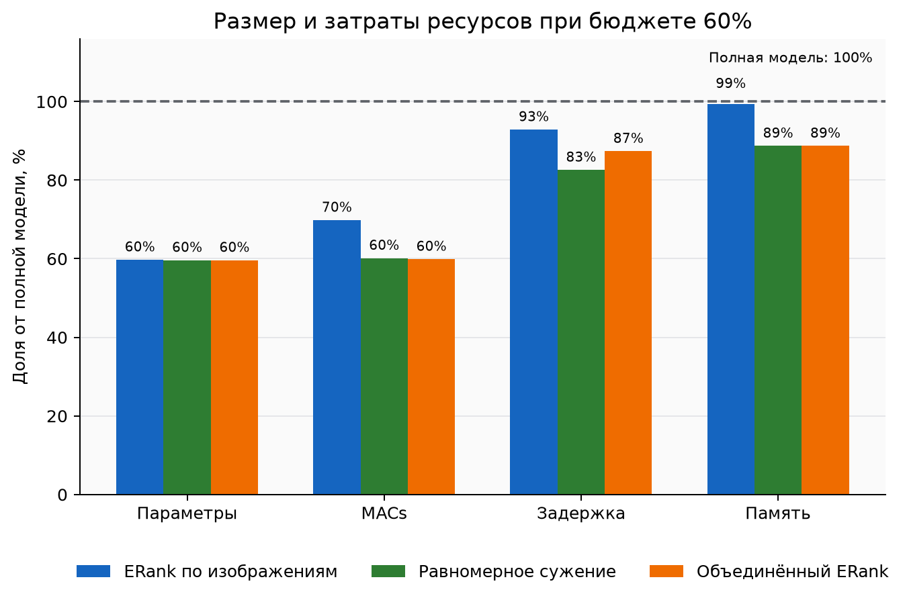
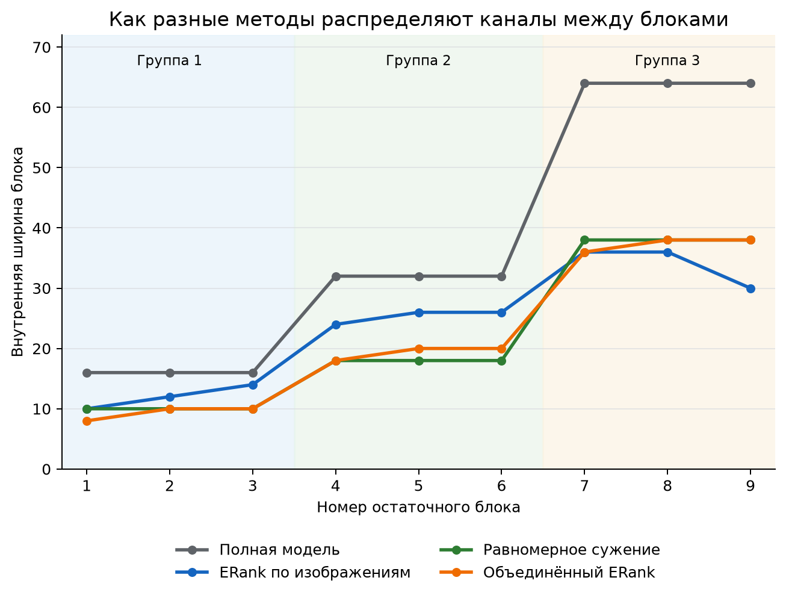

# Поиск компактной архитектуры ResNet-20 с помощью эффективного ранга

## Итоговый отчёт по проекту

# Краткий итог

В работе проверялось, можно ли сделать нейронную сеть ResNet-20 меньше без
большой потери точности. Для этого мы оценивали, насколько полезны внутренние
каналы каждого блока сети, а затем оставляли разное число каналов в разных
блоках. Главным способом оценки был эффективный ранг, или ERank.

Лучший компактный вариант сохранил около 60% параметров полной модели и получил
точность 91,46% на тестовой выборке. Полная модель получила 92,11%. Значит,
размер модели уменьшился примерно на 40%, а точность снизилась на 0,65
процентного пункта. Этот вариант также оказался лучше равномерного сужения на
0,28 процентного пункта и лучше объединённого ERank на 0,59 процентного пункта.
Однако разница с равномерным сужением мала, поэтому по трём запускам нельзя
считать преимущество окончательно доказанным.

# Цель работы

У свёрточной нейронной сети есть много внутренних каналов. Чем их больше, тем
больше у модели параметров и вычислений. Но не каждый блок обязательно требует
одинаковую долю каналов. Цель проекта состояла в том, чтобы найти более удачное
распределение каналов между блоками ResNet-20.

Мы проверяли следующий вопрос:

> Помогает ли эффективный ранг распределить ограниченное число каналов лучше,
> чем равномерное или случайное сужение сети?

Чтобы ответ был честным, сравниваемые модели имели почти одинаковое число
параметров и обучались по одинаковым правилам.

# Данные и исходная модель

В экспериментах использовался набор CIFAR-10. Он содержит цветные изображения
размером 32 на 32 пикселя и десять классов: самолёты, автомобили, птицы, кошки,
олени, собаки, лягушки, лошади, корабли и грузовики.

Данные были разделены следующим образом:

| Часть данных | Число изображений | Для чего использовалась |
|---|---:|---|
| Обучающая | 45 000 | Изменение весов модели |
| Проверочная | 5 000 | Выбор лучшей эпохи |
| Тестовая | 10 000 | Финальная независимая оценка |

Тестовая выборка не использовалась при обучении и выборе лучшей эпохи. Это
важно: итоговая точность показывает работу модели на изображениях, которые не
влияли на её настройку.

Исходной моделью была ResNet-20. Она состоит из девяти основных остаточных
блоков. В полной модели внутренние ширины этих блоков равны:

`[16, 16, 16, 32, 32, 32, 64, 64, 64]`.

Ширина блока показывает, сколько внутренних каналов используется для обработки
изображения. В проекте менялась только эта внутренняя ширина. Входы и выходы
блоков оставались стандартными, поэтому остаточные связи ResNet продолжали
работать без изменений.

# Что такое эффективный ранг

Обычный ранг матрицы показывает число независимых направлений в данных. Но он
слишком чувствителен к очень маленьким значениям: даже почти бесполезное
направление может увеличить обычный ранг на единицу.

Эффективный ранг решает эту проблему. Сначала для матрицы активаций вычисляются
сингулярные значения. В простом понимании каждое такое значение показывает силу
одного независимого направления. Затем эти значения превращаются в доли:

$$
p_i = \frac{\sigma_i}{\sum_j \sigma_j}.
$$

После этого считается энтропия и сам эффективный ранг:

$$
H = -\sum_i p_i \ln p_i, \qquad r_{eff} = \exp(H).
$$

Если информация распределена по многим направлениям примерно одинаково,
эффективный ранг высокий. Если почти вся информация сосредоточена в нескольких
направлениях, он низкий. Поэтому блок с большим ERank получает больше каналов,
а блок с меньшим ERank может быть сужен сильнее.

Мы проверили три способа расчёта ERank:

1. Отдельно для каждого изображения, после чего значения усреднялись.
2. Для объединённых активаций всех изображений проверочной выборки.
3. Для весов первого свёрточного слоя каждого блока.

В третьем случае получились те же ширины, что и во втором. Поэтому отдельная
модель для ERank весов не обучалась: это было бы повторение уже выполненного
эксперимента.

# Сравниваемые способы сужения

Кроме ERank использовались два простых способа сравнения.

**Равномерное сужение.** Все блоки уменьшаются примерно в одной пропорции. Этот
вариант показывает, даёт ли сложное распределение ширин пользу по сравнению с
простым уменьшением всей сети.

**Случайное сужение.** Каналы случайно распределяются между блоками при том же
общем размере модели. Этот вариант показывает, достаточно ли любого
неравномерного распределения.

Основное сравнение проводилось при бюджете около 60% параметров полной модели.
Дополнительно был проверен более мягкий бюджет около 80%.

# Порядок эксперимента

Работа выполнялась в несколько шагов.

1. Полная ResNet-20 обучалась на обучающей части CIFAR-10.
2. По лучшей сохранённой модели измерялся ERank девяти блоков.
3. По полученным значениям строились компактные архитектуры.
4. Для сравнения создавались равномерная и случайная архитектуры того же размера.
5. Каждая основная модель обучалась с нуля. Для бюджета 60% полная модель и три
   главных компактных варианта были обучены три раза.
6. Лучшие сохранённые модели оценивались на тестовой выборке.
7. На одном GPU измерялись скорость, число операций и расход памяти.

Основные параметры обучения не менялись между сравниваемыми моделями.

| Параметр | Значение |
|---|---:|
| Число эпох при обучении с нуля | 160 |
| Размер пакета | 128 |
| Число повторных запусков для главного сравнения | 3 |
| Основной бюджет параметров | около 60% |
| Дополнительный бюджет параметров | около 80% |

Для каждого запуска менялось начальное случайное состояние. Поэтому повторные
запуски показывают, насколько результат зависит от случайной начальной настройки
весов и порядка обучающих изображений.

# Основные результаты при бюджете 60%

В таблице приведена средняя точность по трём независимым запускам. Знак после
среднего значения показывает стандартное отклонение: чем оно меньше, тем
стабильнее повторялся результат.

| Модель | Параметры | Доля от полной модели | Точность на тестовой выборке |
|---|---:|---:|---:|
| Полная ResNet-20 | 272 474 | 100,0% | 92,11 ± 0,35% |
| ERank по изображениям | 162 790 | 59,7% | 91,46 ± 0,34% |
| Равномерное сужение | 162 470 | 59,6% | 91,18 ± 0,27% |
| Объединённый ERank | 162 470 | 59,6% | 90,87 ± 0,21% |

ERank по отдельным изображениям показал лучший средний результат среди
компактных моделей. Он уступил полной модели 0,65 процентного пункта. При этом
он был выше равномерного сужения на 0,28 процентного пункта и выше объединённого
ERank на 0,59 процентного пункта.

Три отдельных запуска показаны на следующем графике.

Разница между ERank по изображениям и объединённым ERank сохранялась во всех
трёх запусках: 0,38; 0,82 и 0,56 процентного пункта. Разница с равномерным
сужением была менее устойчивой: в первом запуске равномерная модель была выше
на 0,14 пункта, а во втором и третьем ERank был выше на 0,73 и 0,25 пункта.

Из этого следует осторожный вывод. ERank по изображениям выглядит лучше
объединённого ERank. По сравнению с равномерным сужением есть небольшое среднее
преимущество, но трёх запусков недостаточно для строгого доказательства.

# Размер, скорость и память

Число параметров показывает размер модели. MACs приблизительно показывают объём
вычислений для одного пакета. Задержка показывает реальное время обработки, а
память показывает максимальный расход памяти CUDA во время измерения.

| Модель | Параметры | MACs на пакет | Задержка, мс | Изображений в секунду | Память CUDA, МБ |
|---|---:|---:|---:|---:|---:|
| Полная ResNet-20 | 272 474 | 5,22 млрд | 1,309 | 97 757 | 78,2 |
| ERank по изображениям | 162 790 | 3,65 млрд | 1,216 | 105 250 | 77,8 |
| Равномерное сужение | 162 470 | 3,14 млрд | 1,081 | 118 354 | 69,4 |
| Объединённый ERank | 162 470 | 3,13 млрд | 1,144 | 111 889 | 69,4 |

Все компактные модели требуют примерно на 40% меньше параметров. Однако такое
же уменьшение не гарантирует одинаковую скорость. ERank по изображениям оставил
больше каналов в некоторых ранних и средних блоках, поэтому у него больше MACs,
чем у двух других компактных вариантов. Он работает примерно на 7,7% быстрее
полной модели, но равномерное сужение оказалось самым быстрым.

Расход памяти у ERank по изображениям почти не изменился. Это связано с тем,
что во время одного шага память занимают не только параметры, но и промежуточные
данные. Уменьшение числа параметров не всегда пропорционально уменьшает общий
расход памяти.

# Как распределились ширины

На графике видно, что методы по-разному распределяют каналы между девятью
блоками. Полная модель использует одинаковую ширину внутри каждой из трёх групп.
ERank разрешает блокам одной группы иметь разные ширины.

| Метод | Ширины девяти блоков |
|---|---|
| Полная модель | 16, 16, 16, 32, 32, 32, 64, 64, 64 |
| ERank по изображениям | 10, 12, 14, 24, 26, 26, 36, 36, 30 |
| Равномерное сужение | 10, 10, 10, 18, 18, 18, 38, 38, 38 |
| Объединённый ERank | 8, 10, 10, 18, 20, 20, 36, 38, 38 |

ERank по изображениям сохранил больше каналов в средней группе блоков, чем
равномерный способ. В последнем блоке он, наоборот, оставил только 30 каналов.
Именно это перераспределение дало лучшую среднюю точность, но потребовало больше
вычислений.

# Дополнительный бюджет 80%

Для бюджета около 80% все варианты были проверены в одном запуске. Поэтому эти
числа полезны как дополнительное наблюдение, но не дают такой же уверенности,
как результаты трёх запусков при бюджете 60%.

| Модель | Параметры | Точность при обучении с нуля |
|---|---:|---:|
| ERank по изображениям | 218 226 | 92,22% |
| Равномерное сужение | 219 062 | 91,95% |
| Случайное сужение | 218 770 | 91,81% |
| Объединённый ERank | 218 766 | 91,72% |

При этом бюджете ERank по изображениям снова показал лучший результат при
обучении с нуля. Его точность 92,22% оказалась близка к средней точности полной
модели 92,11%. Сравнивать эти два числа нужно осторожно: компактная модель имеет
один запуск, а полная модель три.

# Обучение с нуля и дообучение

Кроме обучения с нуля мы проверили короткое дообучение компактной модели из
весов полной сети. Для переноса выбирались наиболее крупные по норме фильтры.
Такое правило одинаково применялось ко всем методам.

| Бюджет | Модель | С нуля | После дообучения |
|---|---|---:|---:|
| 60% | ERank по изображениям | 91,33% | 91,70% |
| 60% | Равномерное сужение | 91,47% | 91,05% |
| 60% | Объединённый ERank | 90,95% | 91,17% |
| 60% | Случайное сужение | 91,04% | 91,00% |
| 80% | ERank по изображениям | 92,22% | 92,07% |
| 80% | Равномерное сужение | 91,95% | 92,23% |
| 80% | Объединённый ERank | 91,72% | 91,83% |
| 80% | Случайное сужение | 91,81% | 91,66% |

Здесь приведён только первый запуск. Дообучение иногда помогало, а иногда
ухудшало результат. Оно не дало постоянного преимущества. Основной итог проекта
поэтому основан на обучении с нуля и трёх повторных запусках.

# Ограничения

У эксперимента есть несколько ограничений.

1. Полное сравнение по трём запускам выполнено только для бюджета 60% и трёх
   компактных способов. Для случайной архитектуры и бюджета 80% есть только один
   запуск.
2. Архитектуры были найдены по первой полной модели, а затем без изменений
   использованы в повторных запусках. Полный поиск с новым расчётом ERank для
   каждого запуска не выполнялся.
3. Проверялись только ResNet-20 и CIFAR-10. Для других сетей и наборов данных
   результат может отличаться.
4. ERank помогает выбрать число каналов, но не гарантирует лучшую архитектуру.
   Это практическая оценка, которую нужно проверять обучением.
5. Измерение скорости зависит от видеокарты, версии библиотек и размера пакета.
   Сравнивать нужно значения, полученные в одинаковом окружении.

# Выводы

Эксперимент показал, что эффективный ранг можно использовать для построения
компактной ResNet-20.

Основной результат: модель ERank по отдельным изображениям сохранила около 60%
параметров и достигла точности 91,46 ± 0,34%. Это на 0,65 процентного пункта
ниже полной модели. Среди компактных вариантов она показала лучшую среднюю
точность.

Расчёт ERank по отдельным изображениям оказался полезнее расчёта по всем
объединённым активациям. По сравнению с равномерным сужением улучшение было
небольшим. Для более уверенного вывода нужны дополнительные запуски.

Уменьшение параметров не означает такое же уменьшение времени и памяти.
Равномерная модель была быстрее, а ERank по изображениям дал лучшую точность.
Поэтому окончательный выбор зависит от цели: если важнее точность, подходит
ERank; если важнее скорость, равномерное сужение в этом эксперименте выгоднее.

# Использованные работы

1. He K., Zhang X., Ren S., Sun J. Deep Residual Learning for Image Recognition.
   2016.
2. Roy O., Vetterli M. The Effective Rank: A Measure of Effective
   Dimensionality. 2007.
3. Krizhevsky A. Learning Multiple Layers of Features from Tiny Images. 2009.
