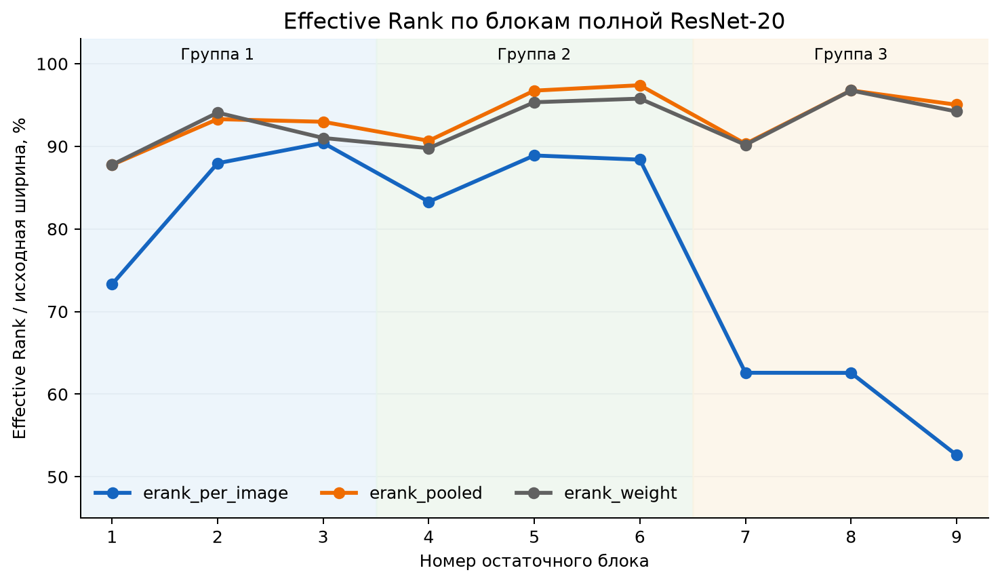
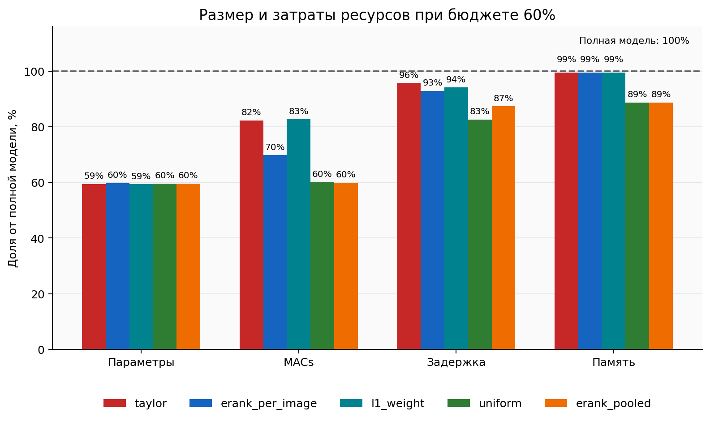

# Effective Rank как критерий выбора компактной архитектуры ResNet-20

## Аннотация

В работе исследуется, насколько Effective Rank полезен для выбора ширины
остаточных блоков нейронной сети по сравнению с классическими критериями
прунинга и простыми контрольными способами. Эксперимент выполнен на ResNet-20
и CIFAR-10. В полной модели изменяемыми являются девять внутренних ширин — по
одной для каждого остаточного блока.

Основное одношаговое сравнение охватывает семь бюджетов: от `p090`, где
сохраняется около 90% параметров полной модели, до `p030`, где сохраняется
около 30%. Рассматриваются `erank_per_image`, `erank_pooled`, `erank_weight`,
`l1_weight`, `taylor`, `uniform` и `random`. Все модели основной сетки обучены
с нуля по одному протоколу при `train_seed=1`. Для `random` на каждом бюджете
проверено десять разных профилей ширин с `architecture_seed=1001...1010`.
Всего выполнено 106 физических обучений и 106 оценок на официальной тестовой
выборке.

Результаты не выявили одного метода, лучшего при любом размере. При слабом
сжатии `p090` и `p080` максимальную точность показал `l1_weight`; на `p070` —
`erank_pooled`; на `p060` и `p050` — `taylor`; на `p040` — `uniform`; при
сильном сжатии `p030` — `erank_per_image`. Следовательно, полезность критерия
зависит от допустимого размера модели и от того, оптимизируется ли число
параметров или число операций.

Effective Rank оказался содержательным критерием построения архитектуры, но не
универсальной заменой классических методов. `erank_per_image` во всех семи
точках превысил средний результат `random`, а на `p030` стал лучшим методом.
`erank_pooled` чаще обеспечивает хорошее соотношение точности и MACs, однако
проигрывает по точности в ряде бюджетов. Повторные обучения на `p060`
показывают, что различия в несколько десятых процентного пункта сопоставимы с
разбросом между запусками. Поэтому окончательные выводы формулируются по форме
кривых и устойчивым различиям, а не по минимальному преимуществу одной точки.
Дополнительные эксперименты на `p080` и `p060` показали, что fine-tune не
всегда превосходит обучение найденной архитектуры с нуля, а реальная задержка
не всегда уменьшается пропорционально MACs. Проверка чувствительности отдельных
блоков при уменьшении ширины на 25% и 50% показала, что последствия сильного
сужения особенно велики для блоков 4, 7, 8 и 9.

---

## 1. Термины и обозначения

Названия методов оставлены такими же, как в коде, конфигурациях и каталогах
результатов.

| Термин | Определение |
|---|---|
| `baseline` | Полная ResNet-20 с внутренними ширинами `[16, 16, 16, 32, 32, 32, 64, 64, 64]`. |
| Бюджет `pXYZ` | Примерная доля параметров, которая остаётся от полной модели. Например, `p060` означает, что сохраняется около 60% параметров, а удаляется около 40%. |
| Внутренняя ширина | Число промежуточных каналов внутри остаточного блока. Чем больше ширина, тем больше информации может обрабатывать блок, но тем больше параметров и операций требуется. |
| `erank_per_image` | Для каждого изображения отдельно оценивается, сколько разных каналов действительно несут неповторяющуюся информацию. Затем результат усредняется по 5 000 проверочным изображениям. |
| `erank_pooled` | Все 5 000 проверочных изображений рассматриваются вместе. Метод оценивает, сколько разных каналов полезно для всей проверочной выборки в целом. |
| `erank_weight` | Оценивается разнообразие фильтров первого сверточного слоя блока. Изображения для этого варианта не нужны. |
| `l1_weight` | Канал считается более важным, если сумма абсолютных значений его весов больше. |
| `taylor` | Оценивается, насколько сильно может измениться ошибка модели после удаления канала. Чем больше ожидаемое изменение, тем важнее канал. |
| `uniform` | Все блоки уменьшаются примерно в одинаковой пропорции. Это простой вариант сравнения без специального критерия важности. |
| `random` | Девять ширин выбираются случайно, но итоговое число параметров остаётся близким к заданному бюджету. |
| `scratch` | Модель получает случайные начальные веса и обучается с нуля. |
| `finetune` | Модель получает часть весов обученной полной сети и затем дообучается. Результаты этого режима не смешиваются с основной `scratch`-сеткой. |
| `train_seed` | Число, которое управляет случайностью обучения: начальными весами и порядком подачи изображений. В текущей реализации оно также влияет на разделение данных на обучающую и проверочную части. |
| `architecture_seed` | Число, по которому воспроизводится случайный выбор девяти ширин для метода `random`. |
| `aliases` | Несколько методов дали одинаковые девять ширин. Такую сеть достаточно обучить один раз, а результат можно отнести ко всем совпавшим методам. |
| MAC | Одна операция умножения с последующим сложением. Используется как оценка вычислительной стоимости. |
| Процентный пункт | Абсолютная разница двух значений точности. Например, 92% минус 91% равно 1 процентному пункту. |
| Стандартное отклонение | Мера разброса результатов вокруг среднего значения. |

## 2. Цель и исследовательские вопросы

Цель работы — определить, помогает ли Effective Rank выбирать компактную
архитектуру ResNet-20 лучше классических критериев `l1_weight` и `taylor`, а
также двух простых способов сравнения: равномерного уменьшения `uniform` и
случайного распределения ширин `random`.

Проверяются следующие вопросы:

1. Как меняется точность каждого метода, когда в модели постепенно остаётся
   всё меньше параметров — от примерно 90% (`p090`) до 30% (`p030`)?
2. Есть ли метод, который выигрывает на всём диапазоне размеров?
3. Насколько результаты методов превосходят случайное распределение ширин?
4. Совпадает ли уменьшение параметров с уменьшением числа операций?
5. Какие способы Effective Rank работают лучше при слабом и сильном сжатии?
6. Всегда ли fine-tune лучше обучения найденной архитектуры с нуля?
7. Насколько изменение MACs совпадает с изменением реальной задержки?
8. Насколько устойчивы выводы к случайности обучения?
9. Согласуются ли значения критериев с чувствительностью отдельных блоков?

Основная гипотеза: если Effective Rank отражает требуемую размерность
представлений, то построенная по нему архитектура должна систематически
превосходить средний `random` и оставаться конкурентоспособной относительно
`l1_weight` и `taylor`.

## 3. Данные, модель и инфраструктура

### 3.1. Данные

CIFAR-10 содержит 60 000 цветных изображений размером 32 × 32 пикселя из
десяти классов. Использовано следующее разделение:

| Часть | Изображения | Назначение |
|---|---:|---|
| Обучающая | 45 000 | Обновление весов модели |
| Проверочная | 5 000 | Выбор лучшей эпохи и расчёт критериев |
| Тестовая | 10 000 | Окончательная независимая оценка |

Тестовая часть не использовалась для обучения, выбора лучшей эпохи или
построения архитектуры. Для обучения применялись случайная обрезка,
горизонтальное отражение и нормализация; для проверки и теста — нормализация.

### 3.2. Модель

Исходная ResNet-20 содержит девять остаточных блоков, объединённых в три
группы. Полные внутренние ширины равны:

```text
[16, 16, 16, 32, 32, 32, 64, 64, 64]
```

В каждом блоке изменяется только промежуточная ширина `M`:

```text
C_in -> Conv1 -> BN -> ReLU -> Conv2 -> C_out
```

Входная и выходная ширины блока остаются стандартными. Поэтому остаточное
сложение не нарушается, а любой допустимый набор из девяти значений можно
обучать одной реализацией модели.

Полная модель содержит 272 474 обучаемых параметра и требует 40 813 184 MACs
на одно изображение. При `train_seed=1` её точность на тестовой выборке равна
92,49%.

### 3.3. Вычислительная инфраструктура

| Компонент | Конфигурация основного запуска |
|---|---|
| Операционная система | Manjaro Linux |
| Процессор | Intel Core Ultra 7 265KF |
| Видеокарта | NVIDIA GeForce RTX 5070 Ti, 16 ГБ |
| Оперативная память | 64 ГБ |
| Python | 3.14.7 |
| PyTorch | 2.14.1+cu130 |
| CUDA runtime PyTorch | 13.0 |
| cuDNN | 92400 |

Точные сведения о программном окружении сохранены в `environment.json`
каждого запуска.

## 4. Как строились архитектуры

### 4.1. Effective Rank

Для матрицы активаций или весов вычисляются сингулярные значения
$\sigma_1, \ldots, \sigma_n$. Они нормируются:

$$
p_i = \frac{\sigma_i}{\sum_j \sigma_j}.
$$

После этого вычисляются энтропия и Effective Rank:

$$
H(p) = -\sum_i p_i \ln p_i,
\qquad
r_{eff} = \exp(H(p)).
$$

Если каналы блока во многом повторяют друг друга, Effective Rank получается
небольшим. Если разные каналы несут разную информацию, он получается выше.

Значение Effective Rank не означает, что в блоке нужно оставить ровно столько
каналов. Оно показывает относительную потребность блоков в ширине. Например,
если один блок получил заметно более высокую оценку, алгоритм старается дать
ему больше каналов, чем блоку с низкой оценкой. При этом общее число параметров
всей сети должно соответствовать выбранному бюджету, например `p060`.

`erank_per_image` выполняет такую оценку отдельно для каждого изображения, а
затем усредняет результаты. Этот вариант показывает, насколько разнообразны
каналы внутри типичного отдельного изображения.

`erank_pooled` объединяет информацию по всем 5 000 проверочным изображениям.
Он показывает, сколько разных каналов полезно для всей выборки в целом.

`erank_weight` анализирует не изображения, а сами фильтры `Conv1`. На шести
бюджетах из семи он дал те же ширины, что и `erank_pooled`; только на `p070`
профили различились. Совпавшие сети обучались один раз, а одинаковые методы
указаны в `aliases`.

Для сравнения блоков значения Effective Rank делятся на исходную ширину блока.
Так видно, какая доля доступных каналов используется как разные направления
информации.



`erank_pooled` и `erank_weight` дают близкие профили: в большинстве блоков их
Effective Rank составляет 88–97% исходной ширины. У `erank_per_image` оценки
последних трёх блоков ниже, особенно у блока 9. Поэтому этот вариант сильнее
сужает конец сети и распределяет больше бюджета между предыдущими блоками.

### 4.2. Классические критерии

`l1_weight` считает канал важным, если сумма модулей весов его фильтра велика.
Критерий прост, не требует данных и градиентов.

`taylor` использует активацию и градиент функции ошибки. Большое произведение
указывает, что удаление канала может заметно изменить ошибку. Для расчёта
использовались 5 000 проверочных изображений. Оптимизатор не выполнял шагов,
поэтому веса на этом этапе не изменялись.

Для обоих критериев оценки нормировались внутри слоя. Затем ширины уменьшались
там, где отношение удаляемой важности к экономии параметров было наименьшим.

### 4.3. Контрольные методы

`uniform` и `random` нужны как простые способы сравнения. `uniform` показывает,
что произойдёт, если уменьшать все блоки примерно одинаково и вообще не
рассчитывать их важность. `random` показывает результат случайного выбора
ширин при том же общем числе параметров.

Одной случайной архитектуры недостаточно: она может случайно оказаться очень
удачной или очень неудачной. Поэтому для каждого бюджета построено десять
разных `random`-архитектур. Например, для `p060` получены десять разных наборов
из девяти ширин, и каждый набор содержит около 60% параметров полной модели.
Затем рассчитываются средняя, минимальная и максимальная точность этих десяти
вариантов.

Их `architecture_seed` изменяется от 1001 до 1010, но все модели основной
сетки обучаются при одном `train_seed=1`. Поэтому различия между ними в первую
очередь показывают влияние выбранных ширин.

## 5. Протокол основной одношаговой сетки

Все компактные модели обучались с нуля по одному протоколу:

| Параметр | Значение |
|---|---:|
| Эпохи | 160 |
| Оптимизатор | SGD с momentum и Nesterov |
| Начальный `learning rate` | 0,1 |
| Изменение `learning rate` | CosineAnnealing |
| Momentum | 0,9 |
| Weight decay | 0,0005 |
| Batch size | 128 |
| AMP | включён на CUDA |
| Выбор лучшей модели | максимум `validation accuracy` |
| `train_seed` основной сетки | 1 |

Исследованы `p090`, `p080`, `p070`, `p060`, `p050`, `p040`, `p030`. На каждом
бюджете есть шесть детерминированных методов и десять `random`-профилей.
Совпадающие детерминированные профили не обучались повторно. Поэтому прямое
произведение 7 × 16 даёт 112 логических точек сравнения, но фактически
потребовалось 106 обучений.

## 6. Результаты расширенной сетки

### 6.1. Точность всех детерминированных методов

Все числа в таблице относятся к `train_seed=1`.

| Бюджет | `erank_per_image` | `erank_pooled` | `erank_weight` | `l1_weight` | `taylor` | `uniform` |
|---|---:|---:|---:|---:|---:|---:|
| `p090` | 92,25% | 91,98% | 91,98% | **92,34%** | 92,01% | 91,97% |
| `p080` | 92,22% | 91,72% | 91,72% | **92,24%** | 92,13% | 91,95% |
| `p070` | 91,76% | **91,94%** | 91,30% | 91,85% | 91,88% | 91,65% |
| `p060` | 91,33% | 90,95% | 90,95% | 91,52% | **91,86%** | 91,47% |
| `p050` | 90,67% | 91,19% | 91,19% | 91,13% | **91,34%** | 90,52% |
| `p040` | 90,33% | 90,20% | 90,20% | 90,58% | 90,57% | **90,63%** |
| `p030` | **89,97%** | 89,62% | 89,62% | 89,72% | 89,28% | 89,17% |


На семи бюджетах победителями становятся пять разных методов: `l1_weight`,
`erank_pooled`, `taylor`, `uniform` и `erank_per_image`. Если двигаться по
таблице от `p090` к `p030`, лидер меняется четыре раза. Это означает, что
вопрос «какой критерий лучший» без указания бюджета поставлен неполно.
`l1_weight` лучше сохраняет точность при слабом сжатии; `taylor` выигрывает в
средней области; варианты Effective Rank становятся лучшими на `p070` и
`p030`.

Особенно важен `p030`: `erank_per_image` превосходит `l1_weight` на 0,25
процентного пункта, `taylor` — на 0,69, `uniform` — на 0,80. Это подтверждает,
что критерий активаций может быть полезнее при жёстком ограничении размера.
Однако одна точка одного `train_seed` ещё не доказывает универсальность этого
преимущества.

### 6.2. Кривые качество–размер


Кривые показывают полную траекторию, а не только две выбранные точки. Основные
наблюдения:

- `erank_per_image` ведёт себя устойчиво: он выше среднего `random` на всех
  бюджетах и не имеет резкого провала в середине диапазона;
- `erank_pooled` и `erank_weight` совпадают в шести точках, но на `p070`
  `erank_pooled` получает 91,94%, а `erank_weight` — 91,30%;
- `l1_weight` силён от `p090` до `p040`, но на `p030` уступает
  `erank_per_image`;
- `taylor` показывает лучший результат на `p060` и `p050`, но резко ухудшается
  на `p030`;
- даже простой способ `uniform` может быть конкурентоспособным: на `p040` он
  показывает лучшую точность среди сравниваемых методов.

### 6.3. Сравнение с десятью случайными архитектурами

Сравнение с `random` отвечает на основной проверочный вопрос: действительно ли
критерий находит полезное распределение ширин или похожий результат можно
получить случайно. Если метод не превосходит среднее значение десяти случайных
архитектур, его преимущество трудно считать убедительным. Десять вариантов
нужны, чтобы вывод не зависел от одного случайно удачного или неудачного набора
ширин.

| Бюджет | Среднее `random` | Отклонение | Минимум | Максимум | Лучший детерминированный метод |
|---|---:|---:|---:|---:|---:|
| `p090` | 91,85% | 0,20 | 91,49% | 92,07% | 92,34% |
| `p080` | 91,75% | 0,20 | 91,51% | 92,18% | 92,24% |
| `p070` | 91,45% | 0,17 | 91,24% | 91,72% | 91,94% |
| `p060` | 91,11% | 0,21 | 90,87% | 91,55% | 91,86% |
| `p050` | 90,59% | 0,17 | 90,37% | 90,93% | 91,34% |
| `p040` | 90,09% | 0,29 | 89,70% | 90,55% | 90,63% |
| `p030` | 89,58% | 0,19 | 89,33% | 89,88% | 89,97% |


Лучший детерминированный метод выше среднего `random` на 0,39–0,75
процентного пункта на каждом бюджете. Во всех семи бюджетах он также выше
лучшей из десяти случайных архитектур. На `p060` и `p040` лучшая случайная
архитектура приближается к лидеру, но не превосходит его.


`erank_per_image` — единственный вариант Effective Rank, который выше среднего
`random` во всех семи точках. Его преимущество составляет от 0,08 до 0,47
процентного пункта. У `erank_pooled` и `erank_weight` есть отрицательные точки,
а `taylor` и `uniform` проигрывают среднему `random` на `p030`.

### 6.4. Параметры и MACs — разные ограничения

Число параметров определяет размер весов, но не полностью описывает объём
вычислений. Канал в раннем блоке обрабатывает карту 32 × 32 или 16 × 16 и
используется во многих пространственных позициях. Канал позднего блока работает
с меньшей картой 8 × 8. Поэтому удаление большого числа поздних параметров
может мало уменьшить MACs.

В работе используется MAC как одна операция умножения с последующим сложением.
Если умножение и сложение считать двумя отдельными операциями, то приближённое
число FLOPs равно:

$$
\mathrm{FLOPs} \approx 2 \cdot \mathrm{MACs}.
$$

Например, полная модель требует 40 813 184 MACs, или приблизительно
81 626 368 FLOPs на одно изображение.

| Бюджет | `erank_per_image` | `erank_pooled` | `erank_weight` | `l1_weight` | `taylor` | `uniform` |
|---|---:|---:|---:|---:|---:|---:|
| `p090` | 95,6% | 89,6% | 89,6% | 95,7% | 95,4% | 89,2% |
| `p080` | 90,2% | 78,6% | 78,6% | 91,7% | 91,4% | 81,1% |
| `p070` | 82,6% | 69,4% | 68,7% | 87,0% | 87,0% | 71,5% |
| `p060` | 69,8% | 59,9% | 59,9% | 82,7% | 82,3% | 60,2% |
| `p050` | 57,5% | 50,1% | 50,1% | 78,8% | 77,6% | 50,4% |
| `p040` | 46,9% | 39,3% | 39,3% | 74,5% | 73,7% | 40,1% |
| `p030` | 34,9% | 29,1% | 29,1% | 70,2% | 68,0% | 30,9% |

В таблице показана доля MACs от полной модели. Хотя все методы в строке
`p030` имеют около 30% параметров, `erank_pooled` требует 29,1% исходных MACs,
а `l1_weight` — 70,2%. Причина видна в профилях ширин: `l1_weight` почти
полностью сохраняет первые шесть блоков и экономит параметры в последних.
`taylor` действует похоже: первые блоки у него тоже остаются полными или почти
полными. Ранние блоки обрабатывают изображения большего пространственного
размера, поэтому каждый сохранённый в них канал требует много операций. Из-за
этого у `l1_weight` и `taylor` MACs выше, чем у методов, которые уменьшают сеть
более равномерно.


Если важно уменьшить размер файла модели или объём памяти для её весов, методы
нужно сравнивать внутри одной строки бюджета. Например, все модели `p060`
содержат примерно одинаковое число параметров и поэтому имеют примерно
одинаковый размер файла.

Если важна скорость работы модели, одного числа параметров недостаточно —
нужно дополнительно сравнивать MACs. В этом случае `l1_weight` и `taylor`
оказываются менее экономными: при близком размере модели они требуют заметно
больше операций. По MACs более выгодными часто становятся `erank_pooled`,
`uniform` и иногда `erank_per_image`.

### 6.5. Как методы распределяют ширины


У методов наблюдаются разные устойчивые стратегии:

- `l1_weight` до `p040` сохраняет первые шесть блоков полными и в первую
  очередь сужает блоки 8–9;
- `taylor` действует похоже, но начинает уменьшать среднюю часть раньше;
- `uniform` пропорционально уменьшает все три группы;
- `erank_pooled` и `erank_weight` распределяют уменьшение по всей сети;
- `erank_per_image` дольше сохраняет блоки 2–6 и сильнее сужает последний блок.

Именно эти профили объясняют расхождение между долей параметров и долей MACs.
Они также показывают, что сравниваются не разные способы удалить каналы из
одного профиля, а разные архитектурные решения.

### 6.6. Fine-tune и обучение с нуля

Для `p080` и `p060` дополнительно сравнивались два способа обучения одной и той
же архитектуры:

- `scratch` — случайная инициализация и обучение с нуля в течение 160 эпох;
- `fine-tune` — перенос выбранных по L1 каналов полной модели и дообучение в
  течение 30 эпох.

Все значения ниже относятся к `train_seed=1`.

| Бюджет | Архитектура | Scratch | Fine-tune | Fine-tune минус scratch |
|---|---|---:|---:|---:|
| `p080` | `erank_per_image` | 92,22% | 92,07% | −0,15 п.п. |
| `p080` | `erank_pooled` | 91,72% | 91,83% | +0,11 п.п. |
| `p080` | `uniform` | 91,95% | 92,23% | +0,28 п.п. |
| `p080` | `random` | 91,81% | 91,66% | −0,15 п.п. |
| `p060` | `erank_per_image` | 91,33% | 91,70% | +0,37 п.п. |
| `p060` | `erank_pooled` | 90,95% | 91,17% | +0,22 п.п. |
| `p060` | `uniform` | 91,47% | 91,05% | −0,42 п.п. |
| `p060` | `random` | 91,04% | 91,00% | −0,04 п.п. |

Fine-tune не имеет постоянного преимущества. Он помог обоим вариантам ERank
при `p060`, но при `p080` результат зависел от архитектуры. Следовательно,
удачный профиль ширин не требует обязательного переноса весов: в отдельных
случаях обучение с нуля даёт такой же или лучший результат.

Для `l1_weight` и `taylor` в этом эксперименте выполнено только обучение с
нуля. Поэтому таблица не используется для сравнения всех критериев между
собой, а отвечает только на вопрос о влиянии способа инициализации при
фиксированных ширинах.

### 6.7. Реальное время инференса

MACs позволяют сравнить объём вычислений независимо от устройства, но реальная
задержка зависит от видеокарты, формы тензоров и эффективности CUDA-операций.
Поэтому модели `p080` и `p060` дополнительно измерялись на NVIDIA GeForce
RTX 5070 Ti при batch size 128. В таблице приведена медианная задержка одного
пакета.

| Метод | `p080`, мс | `p060`, мс | Изображений/с на `p060` |
|---|---:|---:|---:|
| `baseline` | 1,309 | 1,309 | 97 757 |
| `erank_per_image` | 1,290 | 1,216 | 105 250 |
| `erank_pooled` | 1,415 | 1,144 | 111 889 |
| `uniform` | 1,342 | **1,081** | **118 354** |
| `l1_weight` | **1,280** | 1,233 | 103 828 |
| `taylor` | 1,285 | 1,254 | 102 112 |
| `random` | 1,317 | 1,162 | 110 172 |



Снижение MACs не всегда пропорционально уменьшает задержку. Например,
`erank_pooled` при `p080` имеет меньше MACs, чем `l1_weight`, но работает
немного медленнее. Причина в том, что GPU по-разному эффективно обрабатывает
разные размеры тензоров. Поэтому MACs удобны для общего сравнения, а реальную
скорость нужно измерять на целевом устройстве.

## 7. Устойчивость к случайности обучения

Расширенная сетка использует один `train_seed`, поскольку её задача — получить
форму кривых на большом числе архитектур. Для проверки влияния обучения ранее
выполнено по три независимых запуска пяти методов на `p060`.

| Метод | `seed1` | `seed2` | `seed3` | Среднее ± отклонение |
|---|---:|---:|---:|---:|
| `taylor` | 91,86% | 91,41% | 91,69% | **91,65 ± 0,23%** |
| `erank_per_image` | 91,33% | 91,85% | 91,20% | **91,46 ± 0,34%** |
| `l1_weight` | 91,52% | 91,22% | 91,55% | **91,43 ± 0,18%** |
| `uniform` | 91,47% | 91,12% | 90,95% | **91,18 ± 0,27%** |
| `erank_pooled` | 90,95% | 91,03% | 90,64% | **90,87 ± 0,21%** |


Разница средних между `taylor` и `erank_per_image` равна 0,19 процентного
пункта, а между `erank_per_image` и `l1_weight` — 0,03. Эти значения меньше
или сопоставимы со стандартным отклонением. Поэтому утверждать строгое
превосходство одного из этих трёх методов на `p060` нельзя. Более надёжный
вывод состоит в том, что они образуют конкурентную группу, а
`erank_pooled` в данном бюджете заметно слабее.

Разброс `random` и разброс повторных обучений отвечают на разные вопросы.

- Для `random` берутся десять разных наборов ширин, но используется один
  `train_seed=1`. Такой разброс показывает, насколько результат зависит от
  случайно выбранной архитектуры.
- При повторных обучениях набор из девяти ширин остаётся тем же, но меняется
  `train_seed`. Такой разброс показывает, насколько результат одной архитектуры
  может изменяться от запуска к запуску. В текущей реализации вместе с seed
  меняются начальные веса, порядок изображений и разделение данных на
  обучающую и проверочную части.

## 8. Чувствительность отдельных блоков

Для дополнительной проверки каждый блок полной модели по очереди сужался на
25%, а затем на 50%. Остальные блоки не изменялись, веса переносились по одному
правилу L1, дообучение не выполнялось. Поэтому опыт показывает непосредственное
падение точности после сужения, а не способность модели восстановиться после
дополнительного обучения.


| Блок | Исходная ширина | Ширина −25% | Падение при −25%, п.п. | Ширина −50% | Падение при −50%, п.п. |
|---|---:|---:|---:|---:|---:|
| 1 | 16 | 12 | 0,24 | 8 | 1,02 |
| 2 | 16 | 12 | 0,20 | 8 | 0,54 |
| 3 | 16 | 12 | 0,76 | 8 | 4,00 |
| 4 | 32 | 24 | 3,16 | 16 | 12,64 |
| 5 | 32 | 24 | 0,58 | 16 | 2,90 |
| 6 | 32 | 24 | 1,00 | 16 | 2,58 |
| 7 | 64 | 48 | 3,72 | 32 | 12,56 |
| 8 | 64 | 48 | 4,02 | 32 | 10,68 |
| 9 | 64 | 48 | 4,24 | 32 | 23,36 |

При уменьшении на 25% наиболее чувствительными были блоки 7–9 и блок 4:
точность снижалась на 3,16–4,24 процентного пункта. Уменьшение на 50%
подтвердило этот вывод и сделало различия заметнее. Самым чувствительным стал
блок 9: проверочная точность упала с 92,36% до 69,00%, то есть на 23,36
процентного пункта. Для блоков 4, 7 и 8 падение составило 10,68–12,64 пункта.
Блоки 1 и 2 перенесли сужение лучше остальных.

| Критерий | Корреляция при −25% | Корреляция при −50% |
|---|---:|---:|
| `erank_per_image` | −0,67 | −0,52 |
| `erank_pooled` | 0,23 | −0,05 |
| `erank_weight` | 0,30 | −0,02 |
| `l1_weight` | 0,32 | 0,28 |
| `taylor` | **0,60** | **0,32** |

При уменьшении на 25% лучшую положительную связь с реальным падением показал
`taylor`: корреляция Спирмена равна 0,60. При уменьшении на 50% эта связь стала
слабее, но `taylor` сохранил наибольшее положительное значение — 0,32. Это
означает, что порядок чувствительности блоков зависит не только от критерия,
но и от силы сужения.

У `erank_per_image` корреляция отрицательная: −0,67 при уменьшении на 25% и
−0,52 при уменьшении на 50%. Это не противоречит его конкурентной точности
целой сети. Локальная проверка задаёт вопрос «что
произойдёт, если независимо сузить один блок без дообучения», а построение
архитектуры распределяет общий бюджет сразу между девятью блоками и затем
обучает новую сеть с нуля. Критерий может быть полезен для общего профиля и
при этом плохо служить прямой оценкой локальной чувствительности.

Есть и дополнительное ограничение: уменьшение каждого блока на одну долю
означает разное число удалённых параметров. В поздних широких блоках удаляется
больше параметров, чем в ранних узких блоках. Поэтому этот опыт показывает
реакцию на одинаковую долю удалённых каналов, но не является сравнением блоков
при строго одинаковом уменьшении размера модели или MACs.

## 9. Ответ на основной вопрос проекта

Effective Rank полезен, но его преимущество зависит от режима сравнения.

1. **По точности при равном числе параметров.** Нет универсального победителя.
   `l1_weight` лучше при слабом сжатии, `taylor` — в средней области,
   `erank_per_image` — при самом сильном исследованном сжатии. Effective Rank
   конкурентоспособен, но не заменяет классические критерии во всех условиях.

2. **По сравнению со случайным выбором архитектуры.** `erank_per_image`
   устойчиво выше среднего `random` на всех семи бюджетах. Это показывает, что
   он извлекает полезный сигнал, а не просто создаёт произвольный профиль.

3. **По числу операций.** `erank_pooled` и `uniform` обычно уменьшают MACs
   почти пропорционально параметрам. `l1_weight` и `taylor` сохраняют ранние
   дорогие блоки и поэтому при том же размере требуют существенно больше
   операций. Если цель — ускорение, сравнение только по параметрам может дать
   неверный практический выбор.

4. **По слоям.** Effective Rank лучше работает как правило построения полного
   профиля ширин, чем как прямая локальная оценка безопасности удаления каналов.
   При сужении отдельных блоков на 25% и 50% `taylor` согласуется с измерениями
   лучше остальных проверенных критериев. Наиболее осторожно следует сужать
   блоки 4, 7, 8 и особенно блок 9.

5. **По вариантам Effective Rank.** `erank_per_image` наиболее устойчив
   относительно `random` и выигрывает на `p030`. `erank_pooled` даёт хорошие
   точки по MACs и выигрывает на `p070`, но его точность менее стабильна по
   бюджетам. `erank_weight` почти всегда повторяет `erank_pooled`, а в
   единственной отличающейся точке `p070` показывает худший результат.

## 10. Ограничения и дальнейшая проверка

- Расширенная сетка построена по одной исходной `baseline` и обучена при одном
  `train_seed`. Повторные запуски выполнены только для `p060`.
- Исследование относится к ResNet-20 и CIFAR-10; перенос выводов на другие
  модели требует отдельной проверки.
- Выполнен одношаговый поиск: критерии вычислены один раз по полной модели.
- MACs являются точным счётом сверточных и линейных операций для данной
  реализации, но не равны реальной задержке на любом устройстве. Реальная
  задержка измерена только для `p080`, `p060` и полной модели.
- Основная сетка оценивает архитектуру в режиме `scratch`. Сравнение с
  `fine-tune` выполнено только для `p080` и `p060` при `train_seed=1`.

Следующий этап исследования разделён на две части. Сначала отдельно
сравниваются способы переноса каналов при фиксированных ширинах, чтобы не
смешивать качество архитектуры с качеством инициализации. Затем выполняется
итеративный поиск: после изменения сети критерий рассчитывается повторно, и
архитектура уточняется несколькими шагами.

## 11. Воспроизводимость

Полные команды воспроизведения приведены в `README.md` и
`V08_GRID_RUNBOOK.md`. Основные машиночитаемые результаты находятся в:

- `configs/generated_v4/manifest.json` — состав сетки;
- `reports/data/final_results.json` — повторения `p060`, результаты fine-tune,
  измерения ресурсов и чувствительность блоков при сужении на 25% и 50%;
- `reports/data/grid_results_v09.json` — проверенная сводка v09;
- `results/summary_v09/summary.json` — полная сводка;
- `results/summary_v09/method_points.csv` — таблица логических точек;
- `results/summary_v09/summary.md` — краткая таблица результатов.

Сводка и графики перестраиваются без обучения:

```bash
python -m project_rank.grid_analysis
python -m project_rank.plot_results
python -m project_rank.plot_grid_results
```

## 12. Итоговые выводы

1. Расширение сетки с двух до семи бюджетов изменило интерпретацию результата:
   лидер зависит от степени сжатия.
2. `erank_per_image` систематически превосходит средний `random` и лучше всех
   сохраняет точность при `p030`.
3. `l1_weight` и `taylor` дают высокую точность, но часто сохраняют слишком
   много вычислений в ранних блоках.
4. `erank_pooled` полезен при ограничении MACs, особенно в средней части
   диапазона, но не всегда выигрывает по точности.
5. На `p060` различия `taylor`, `erank_per_image` и `l1_weight` сопоставимы с
   разбросом обучения; небольшие различия одной точки нельзя переоценивать.
6. Для ResNet-20 Effective Rank следует рассматривать как один из способов
   распределения общего бюджета между блоками, а не как универсальный критерий
   удаления отдельного канала или слоя.
7. Fine-tune не имеет постоянного преимущества перед обучением найденной
   архитектуры с нуля: результат зависит от бюджета и профиля ширин.
8. MACs описывают объём вычислений, но не полностью предсказывают реальную
   задержку; скорость нужно дополнительно измерять на целевом устройстве.
